<p align="center">
  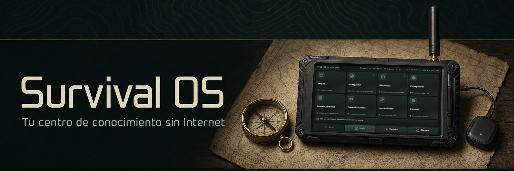
</p>

<p align="center">
  
  
  
  
  
  
</p>

<p align="center"><a href="README.md">Español</a> · <b>English</b></p>

# Survivelia OS

> 🤖 **Let your AI assistant install it:** clone this repository, open it with Claude Code, Codex or Gemini and ask
> "Install Survivelia OS on my Raspberry Pi" (or "on this computer"). It installs and configures everything, and only
> asks you what it needs to know. [How to do it](#express-install-ask-your-ai-assistant).

**A knowledge, maps and communications hub that works without the Internet.** Maps of any country with routing,
place search, Wikipedia, 41 emergency protocols, hundreds of manuals, a local AI assistant, field tools (Sun and
Moon, SOS signals, emergency frequencies, rations), notes and checklists, LoRa radio messaging and an encrypted vault,
in Spanish, English, French or Italian. It updates itself with signed releases.

It runs in three ways:

- as a **dedicated terminal** on a Raspberry Pi 5 with a touch screen;
- as a **portable app** on Windows, macOS or Linux, from a USB drive or installed on the computer;
- as an **Android app** (APK) on a tablet or phone.

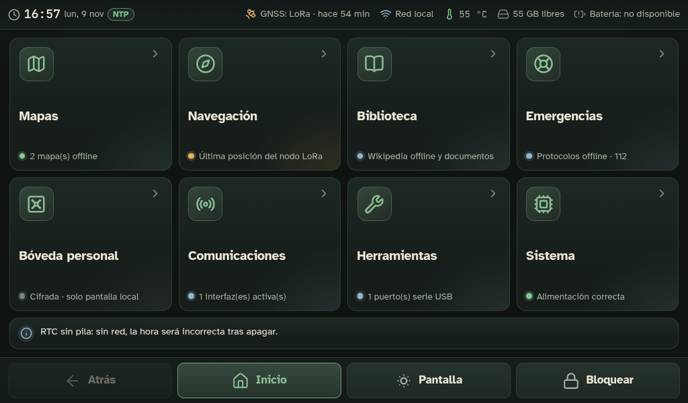

> Real screenshots from the device (Raspberry Pi 5, 8 GB, 1024×600 screen) with real data. They show the Spanish
> interface; the map is centred on Madrid and network addresses are blurred.

## Contents

- [What it is](#what-it-is)
- [Express install: ask your AI assistant](#express-install-ask-your-ai-assistant)
- [Choose how to use it](#choose-how-to-use-it)
- [Getting started with the portable version](#getting-started-with-the-portable-version)
- [Getting started on a Raspberry Pi](#getting-started-on-a-raspberry-pi)
- [Getting started on Android](#getting-started-on-android)
- [First run: set everything up with one click](#first-run-set-everything-up-with-one-click)
- [Features](#features)
- [Languages and country](#languages-and-country)
- [Downloadable content](#downloadable-content)
- [Updates, backups and USB](#updates-backups-and-usb)
- [Hardware](#hardware)
- [For developers](#for-developers)
- [Status](#status)
- [Documentation](#documentation)

## What it is

Survivelia OS is a reference and communications tool for when there is no Internet: a long blackout, an area with no
coverage, a trip into the mountains or an emergency. Everything it needs is downloaded once and stays on the device.

- **Truly offline.** Once the content is downloaded, nothing leaves the device: no CDNs, no web fonts, no remote APIs.
  A CSP policy blocks them and `test-offline.sh` checks it.
- **Honest data.** If something cannot be measured, the screen says "unavailable" and why; it never shows a made-up
  value. When a value is estimated or comes from another source (for example, the position of a LoRa node from 7
  days ago), it says so too.
- **Built for fingers.** Large buttons, an always-visible action bar, night mode and its own on-screen keyboard. On
  the Pi it boots straight into kiosk mode.
- **Private.** The interface only listens on the device itself. The vault and the assistant are never reachable from
  the network.

## Express install: ask your AI assistant

This repository is set up so that **an AI assistant can install and configure it for you, in plain language**. You
just answer its questions: where you want it, your Raspberry Pi's IP address and user, the language and the country.

With **[Claude Code](https://claude.com/claude-code)**, **[OpenAI Codex CLI](https://github.com/openai/codex)** or
**[Gemini CLI](https://github.com/google-gemini/gemini-cli)** installed:

```sh
git clone https://github.com/crazyramirez/Survivelia-OS.git
cd Survivelia-OS
claude "Install Survivelia OS on my Raspberry Pi and download everything in English"
```

Codex and Gemini work the same way; only the last line changes:

```sh
codex "Install the portable version of Survivelia OS on this computer"
gemini -i "Set up Survivelia OS in French for France and download everything"
```

**What the assistant can do** (its instructions are in [AGENTS.md](AGENTS.md)):

- **Raspberry Pi or Linux:**
  - guides you through preparing the card with Raspberry Pi Imager and finding the IP address;
  - sets up SSH access; you type the password yourself, once;
  - builds, installs, verifies and reboots into kiosk mode.
- **Portable version:** builds it for your system (Windows, macOS or Linux), copies it wherever you say (a USB drive
  too) and opens it or installs it with a shortcut.
- **Configuration:** language, country, "Download everything", device status and updates.
- **Safety:** before installing or starting large downloads it tells you what it is about to do and waits for your
  confirmation. It never stores passwords.

**No AI assistant?** The same steps, one command each (requires [Node 24](https://nodejs.org) or later):

```sh
npm run express -- doctor                                         # what this computer is missing
npm run express -- portable                                       # portable version for this computer, ready and open
npm run express -- pi --host 192.168.1.50 --user pi --yes --reboot  # install on a Raspberry Pi over SSH
npm run express -- download --host 192.168.1.50 --user pi --yes   # "Download everything" on the Pi
npm run express -- update --host 192.168.1.50 --user pi --check   # is there a new version?
```

Replace the IP address and user with your Pi's. All options are listed at the top of
[scripts/express.mjs](scripts/express.mjs).

## Choose how to use it

| | **Portable** (Windows, macOS, Linux) | **Raspberry Pi 5** (dedicated terminal) | **Android** (tablet or phone) |
|---|---|---|---|
| Who it is for | Trying it in minutes, carrying it on a USB drive or using it on your computer | Your own survival device, always ready | A tablet you already have, with battery, GPS and touch screen |
| Installation | Unzip a folder and open it; nothing to install | Install Survivelia OS on Raspberry Pi OS (a few minutes) | Install the APK and accept the permissions |
| Screen | A window on your computer | Full-screen touch display (kiosk) | Full screen; can be pinned (kiosk) |
| Features | All of them: maps, library, assistant, USB LoRa and GPS, vault, games | All of them, plus its own Wi-Fi hotspot, backup time from GPS/LoRa and Wi-Fi control | All of them, with the tablet's GPS and battery; LoRa and GPS over USB OTG |
| Where your data lives | In the app's own `data/` folder | In `/var/lib/survival-os` | In the `SurvivalOS` folder (internal storage or microSD) |

All three versions share the same code and the same interface: what you learn on one works on the others.

## Getting started with the portable version

### 1. Get the folder

The portable version is a folder called **"Survivelia OS"** (about 590 MB; about 210 MB zipped). It includes
everything needed for all five systems, Node included: there is nothing to install first.

- **Download it** from the [latest release](https://github.com/crazyramirez/Survivelia-OS/releases/latest)
  (`survival-os-X.Y.Z-portable.zip`) and unzip it wherever you like: a USB drive (exFAT works best), an external disk
  or your user folder. For a polished USB drive (icon, name, "open on connect"), open it and use
  System → Maintenance → **USB drive** → "Prepare a USB drive".
- **If you are starting from the source code:** follow [Build the portable version](#build-the-portable-version) in
  the developer section; the result ends up in `release/portable/Survivelia OS/`.

### 2. Open it

| System | How to open it |
|---|---|
| **Windows 10/11** (x64) | Double-click **"Survivelia OS"** (the one with the compass) |
| **macOS 11 or later** (Apple Silicon and Intel) | Double-click **"Survivelia OS"**. The first time, macOS may block it because it is not signed: right-click → **Open** → **Open** |
| **Linux** x64 and arm64 (including 64-bit Raspberry Pi OS) | Double-click **`abrir-survival-os.sh`** (Run) or, in a terminal, `sh abrir-survival-os.sh` |

Survivelia OS opens in **its own window** and stops when you close it. It works best if the computer has Chrome, Edge,
Brave or Chromium. If none is installed, it opens in the default browser; in that case, to quit:
**System → "Close Survivelia OS"**.

> **If macOS says the app "is damaged":** open Terminal and run
> `xattr -dr com.apple.quarantine "/path/to/Survivelia OS"`.
> **If Linux won't run it from the USB drive:** some distributions mount USB drives without execute permission;
> copy the folder to your disk.

### 3. Follow the welcome screen

The first time, the [welcome screen](#first-run-set-everything-up-with-one-click) appears: you choose the language
and country and, with **one click**, everything you need is downloaded. You only need the Internet during the
download.

### Using it from USB or installing it on the computer

- **From the USB drive, without installing anything:** the app does not modify the system. Your maps, documents and
  downloads are stored in the `data/` folder inside the app folder, so you can take everything to another computer.
- **Installing it on this computer** (optional): inside the app, **System → Maintenance → "Install on this
  computer"**. It copies the app and your data to the user's applications folder and creates a shortcut (Start menu
  and desktop on Windows; Applications on macOS; the applications menu on Linux). It does not ask for administrator
  rights.
- **Before removing the USB drive:** close the Survivelia OS window and wait a few seconds.
- **Uninstall:** close the app and delete the folder (and the shortcut, if you installed it).
- **If something goes wrong:** logs are in `data/logs/`.

## Getting started on Android

You need a tablet or phone with **Android 10 or later** (64-bit). Everything works with 3–4 GB of RAM; the assistant
then uses a lightweight model.

1. **Install the APK** `survival-os-X.Y.Z-android-arm64.apk`, which is attached to every
   [published release](https://github.com/crazyramirez/Survivelia-OS/releases/latest) alongside the portable and Pi
   versions: open it on the tablet (Android will ask you to allow "install unknown apps") or, from a computer,
   `adb install`. To build it from the source code, see [For developers](#for-developers).
2. **Choose where to store the data.** The **SurvivalOS** folder on internal storage or the microSD card is kept even
   if you uninstall the app (it asks for "all files access").
3. **Accept the permissions:**
   - notifications;
   - location, to use the tablet's GPS without the Internet;
   - unrestricted battery, so downloads, the radio and GPS keep running with the screen off.
4. **Follow the welcome screen**, as in the other versions.

- **Hardware:** the LoRa radio (Meshtastic), a USB GPS and ESP32 boards connect with an OTG cable; when you plug them
  in, Android offers to open Survivelia OS.
- **Sharing with other phones:** turn on the tablet's hotspot and "Share on the local network".
- **Pinning the screen** (kiosk) and the permissions are under Maintenance → "Survivelia OS for Android".
- **On some brands** (Realme, Xiaomi, Huawei…) also enable "Autostart" and "Background activity" in the app's
  settings.
- **If something goes wrong:** logs are in `SurvivalOS/logs/`.

Technical details: [ADR 0020](docs/adr/0020-app-android.md) (in Spanish).

## Getting started on a Raspberry Pi

### What you need

- A **Raspberry Pi 5** (tested with 8 GB) and its power supply.
- A **microSD card or SSD of 128 GB or more** with **Raspberry Pi OS (Bookworm, 64-bit) with desktop**. The easiest
  way to prepare it is [Raspberry Pi Imager](https://www.raspberrypi.com/software/).
- A screen (tested with a 7" 1024×600 HDMI touch screen) and an Internet connection for the installation.
- A computer with **Node 24.15 or later** to build the installation package.

### Install

1. **On the computer**, build the package:

   ```sh
   npm install
   node scripts/fetch-map-assets.mjs        # map fonts and icons (first time only)
   npm run build && npm run release         # → release/survival-os-X.Y.Z.tar.gz
   ```

2. **Copy it to the Pi** together with the installer (replace `<user>` and `<IP>` with your Pi's):

   ```sh
   scp release/survival-os-*.tar.gz scripts/install-system.sh <user>@<IP>:/tmp/
   ```

3. **On the Pi**, install it:

   ```sh
   sudo bash /tmp/install-system.sh /tmp/survival-os-X.Y.Z.tar.gz
   ```

4. **Reboot the Pi.** It boots straight into Survivelia OS, full screen, with the
   [welcome screen](#first-run-set-everything-up-with-one-click).

The installer:

- puts the application in `/opt/survival-os` and creates the `survival` service user;
- installs the `survival-*` services, each one sandboxed and listening only on the device itself;
- enables kiosk mode for the desktop user, which it detects by itself;
- keeps the previous version so you can roll back.

To uninstall: `sudo bash /opt/survival-os/current/scripts/uninstall-system.sh`. The
[commissioning guide](docs/commissioning.md) (in Spanish) explains each step in more detail (screen, touch, GPS,
LoRa).

## First run: set everything up with one click

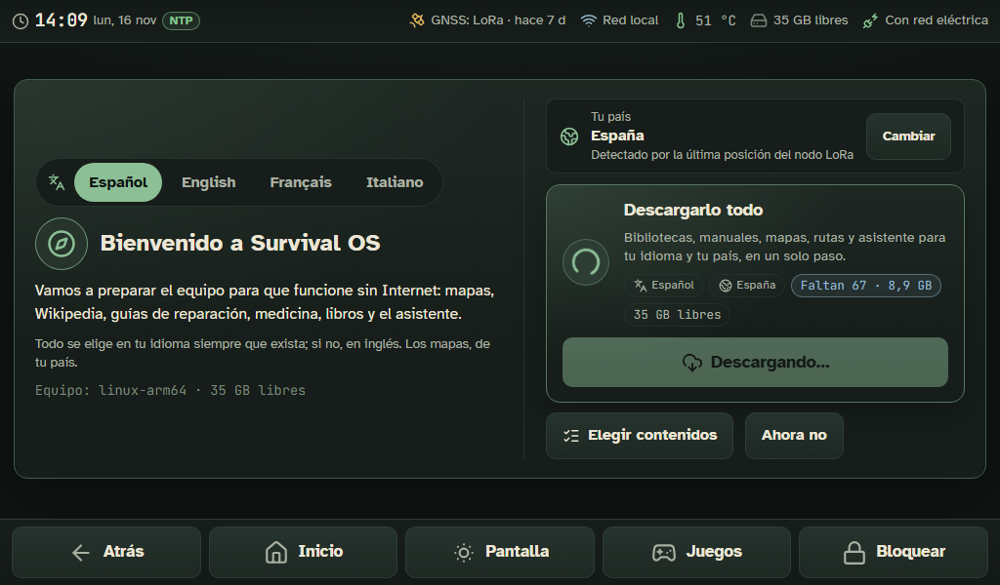

The welcome screen appears only once and fits on a single screen:

1. **Language.** The device's language is suggested (browser and time zone); change it by tapping *Español*,
   *English*, *Français* or *Italiano*.
2. **Country.** Detected without the Internet, from the GNSS position or the LoRa node's position if available, and
   otherwise from the time zone. The screen says how it was detected. "Change" lets you pick any other.
3. **"Download everything".** One click downloads everything recommended for your language and country:
   - library, manuals, maps and routing;
   - the assistant with all its models;
   - the games.

   It fits the selection to the free space and tells you what does not fit.

While it downloads **you can use the device**: whatever is already installed works right away, and progress shows on
the home screen. Depending on your connection, reaching 100% can take hours. If the network drops or you switch the
device off, starting it again **resumes where it left off**.

Rather choose for yourself? **"Choose content"** shows the full catalogue by group, with everything recommended
already ticked. **"Not now"** leaves the setup for later (System → Maintenance → Content).

## Features

### Emergency: 41 protocols and a printable guide

<table><tr>
<td>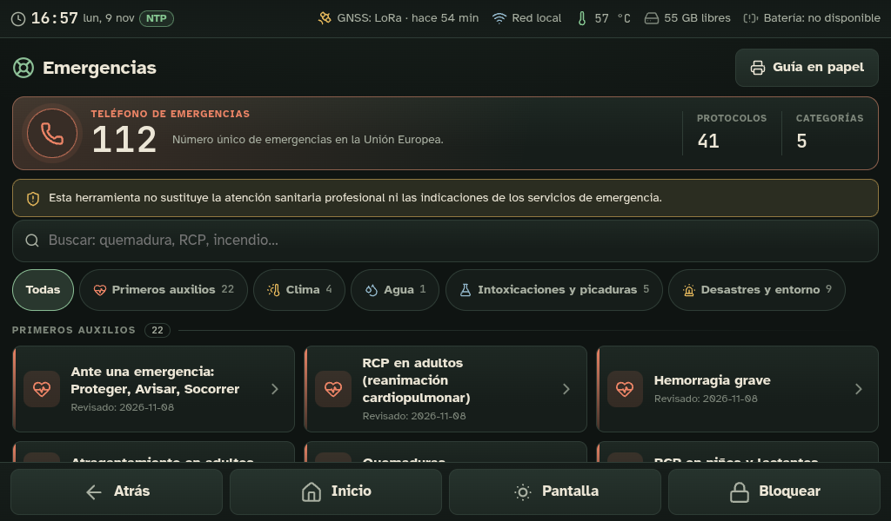</td>
<td>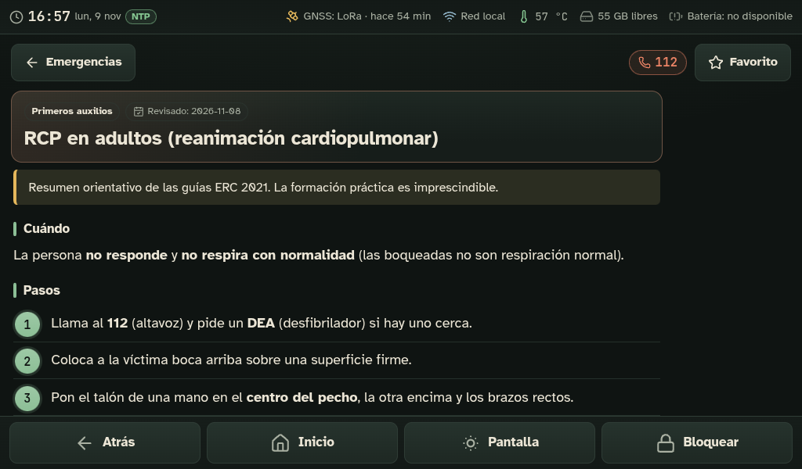</td>
</tr></table>

- **41 protocols** in 5 categories (first aid, weather, water, poisoning and bites, disasters and environment): CPR,
  bleeding, choking, burns, hypothermia, heatstroke, water purification, fires, floods…
- Each protocol lists its **sources and review date** (for example, the ERC 2021 guidelines), with numbered steps and
  clear warnings.
- Available in **Spanish, English, French and Italian**. The translations keep the same figures and doses (checked
  automatically) and state that, when in doubt, the Spanish original prevails.
- Instant search, favourites and one-tap access to **112**.
- **Paper guide:** from Emergency you can print (or save as PDF to a USB drive) a guide with all the protocols, in the
  interface language, so you have it even if the device runs out of battery.

### Maps of any country, with walking, cycling and driving routes

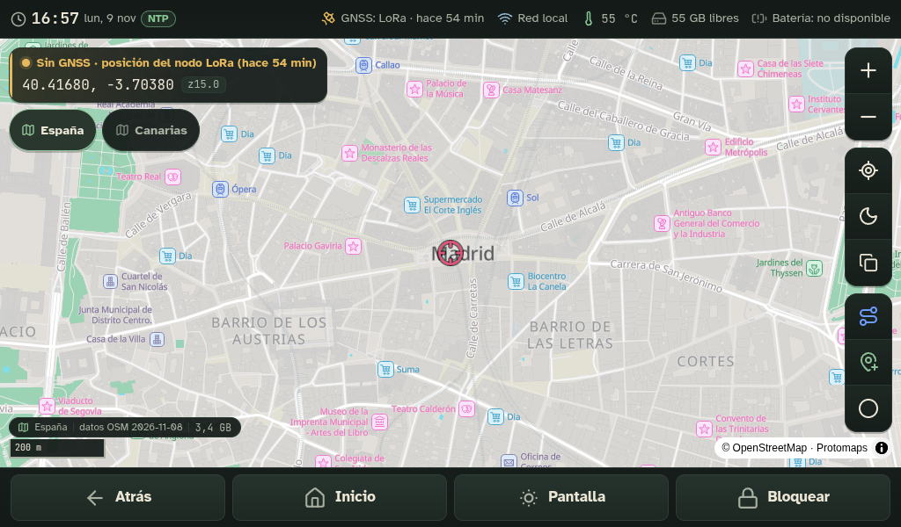

- **Any country in the world:** **"Add country"** (in Maps or in Maintenance) searches 242 countries by name in any of
  the four languages, shows the approximate size and downloads it with one tap.
  - **Detail:** street level in countries like Spain; somewhat less in very large countries, so they fit.
  - **Islands and territories:** nearby ones are included (the Canary Islands with Spain, Alaska with the USA);
    distant overseas territories are not downloaded.
- **Spain** has ready-made maps: mainland and Balearic Islands (3.4 GB) and the Canary Islands. There is also a
  general **world map**.
- **Offline routing** with [BRouter](https://github.com/abrensch/brouter), on the device itself, for any downloaded
  country:
  - walking, cycling and driving profiles, with distance, time and elevation gain;
  - GPX export;
  - on the Pi, a 3 km walk is computed in 0.1 s; Madrid → Seville (531 km) in 10.5 s.
- **Offline place search:** towns, neighbourhoods, hamlets and localities from the installed maps, by name, nearest
  first. From a result, **"Route here"** or **"Save as a point"**. The index is built automatically from the maps
  themselves and rebuilt when you add or remove a country.
- **Measure distance and area** by tapping the map or with the centre crosshair.
- **Place names** in the interface language, plus day and night modes.
- **Saved points** by type (water, shelter, danger…), track recording and copyable coordinates.
- **Position:**
  - USB GPS or the LoRa node's GNSS;
  - with no GPS of its own, the map shows the position received by radio from your Meshtastic node, with its age and
    its real accuracy.
- **Direct link to a point:** `/mapas?lat=40.4168&lon=-3.7038&z=15`.

### Library: Wikipedia, guides and manuals, offline

<table><tr>
<td>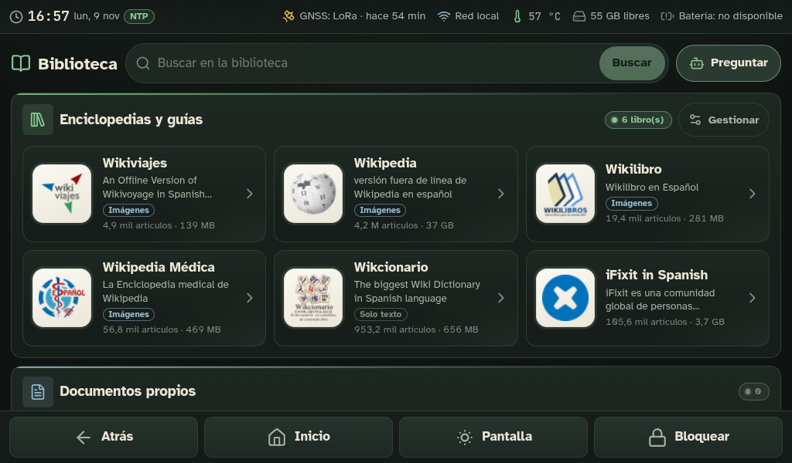</td>
<td>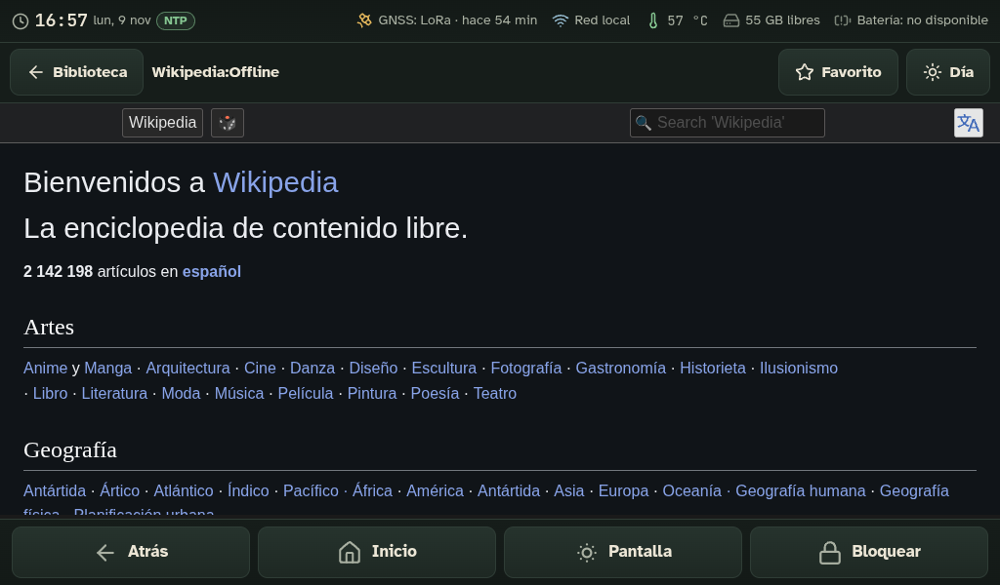</td>
</tr></table>

- **Kiwix encyclopedias and guides**, with a built-in reader designed for the touch screen:
  - Wikipedia and medical Wikipedia;
  - Wikivoyage, Wikibooks, Wiktionary and Wikisource;
  - iFixit (repair guides);
  - MedlinePlus and libraries on water, medicine, food and knots;
  - Q&A forums on DIY, gardening, mechanics, amateur radio and cooking.
- **66 PDF manuals:**
  - health: *Where There Is No Doctor*, MSF, ICRC, WHO;
  - civil protection;
  - agriculture (FAO);
  - navigation and survival.

  They are always downloaded from their official source, verified with SHA-256, and **searchable inside**.
- **Your own documents** (PDF, Markdown, HTML, text), imported from a USB drive, with full-text search.
- **Notes, journal and checklists** (Library → Notes): `- [ ]` lines are checkboxes you tick with a tap, there are
  templates for an **emergency kit** (Ready.gov) and an **incident log**, and notes show up in search and as a source
  for the assistant. They are stored unencrypted; for sensitive data, use the vault.
- **Full-width viewers:** documents with tables, code and quotes, in day and night modes.
- **Built-in PDF viewer:** with zoom (pinch too), night mode and pages that load as you scroll.
- **Nothing takes you out of the app:** links to PDFs or new windows open inside it, always with a back button.
- Unified search across all sources, favourites and night mode.

### Local AI assistant

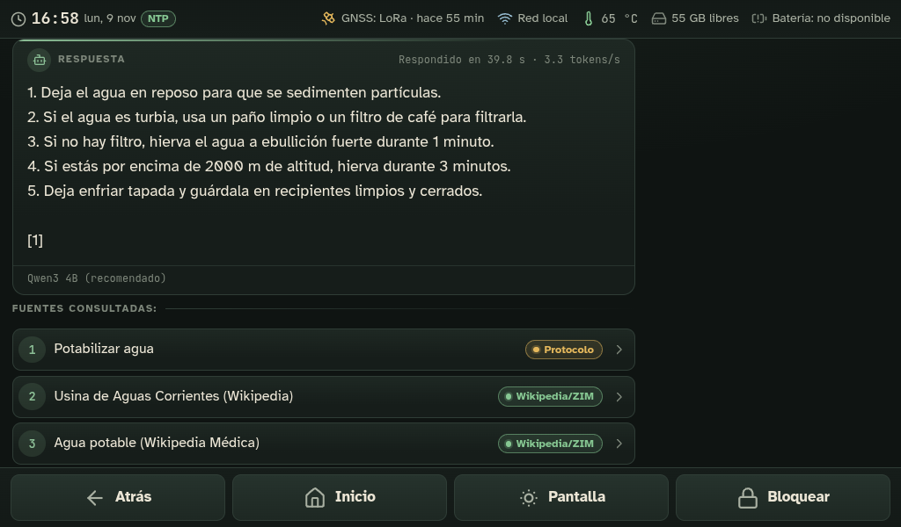

- A language model running **on the device itself** (llama.cpp): Qwen3 4B, the recommended one; Gemma 3 4B and
  Llama 3.2 3B as alternatives. Neither the question nor the answer leaves the device.
- **Sized to the memory:** on devices with little RAM (3–4 GB tablets), models that do not fit are not offered and
  the **lightweight assistant** (Qwen2.5 1.5B, 1.1 GB) stays active.
- **Answers with sources:** it searches the emergency protocols first, then the library, your documents and your
  notes, and **cites what it consulted**. If it finds nothing, it says so instead of making things up.
- Answers **in the language of the question**.
- **Measured performance:**
  - on the Pi 5, about 40–60 s per answer (≈ 3.5 tokens/s);
  - on a modern laptop, much faster (≈ 18 tokens/s measured on Windows).

### Communications: LoRa mesh, hotspot and local network

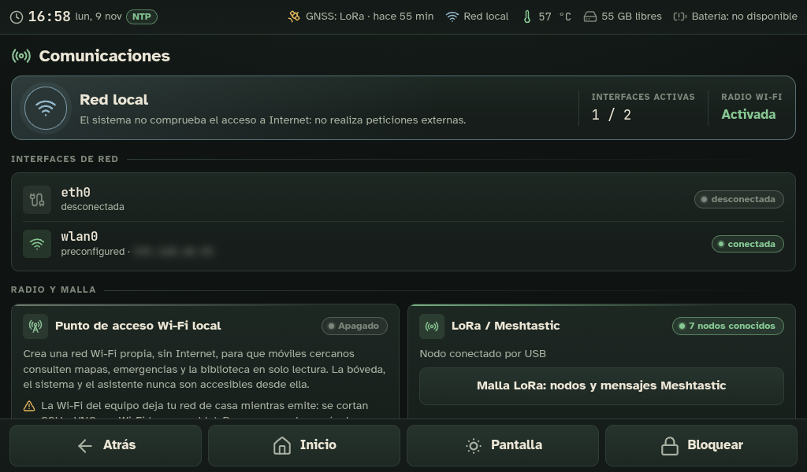

- **LoRa radio messaging** (868 MHz) with Meshtastic nodes over USB:
  - nodes with battery, signal and hops;
  - channels and messages, with no mobile coverage;
  - detected automatically when plugged in, in the portable version too.
- **Base node + pocket node:** one node stays fixed at the device and another goes with you, paired to your phone.
  - The device receives your position **by radio, kilometres away**, over a private encrypted channel.
  - **"Request position now"**, at most once a minute, because of the band's duty cycle.
- **So that nearby phones can browse maps, emergency protocols and the library, read-only and without the
  Internet:**
  - **On the Pi, its own Wi-Fi hotspot:** switched on and off from the screen, with a captive portal; the phone opens
    the app by itself.
  - **In the portable version, "Share on the local network":** phones on the same Wi-Fi get the same.

<table><tr>
<td width="50%">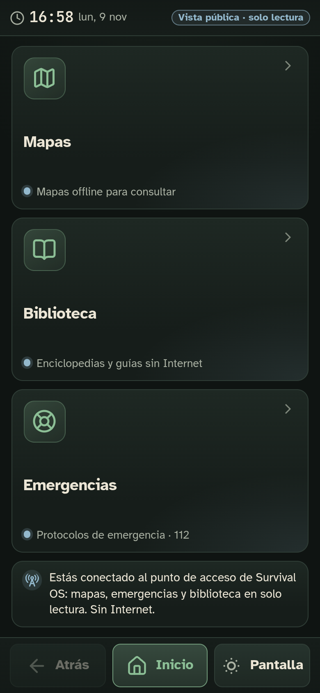</td>
<td width="50%">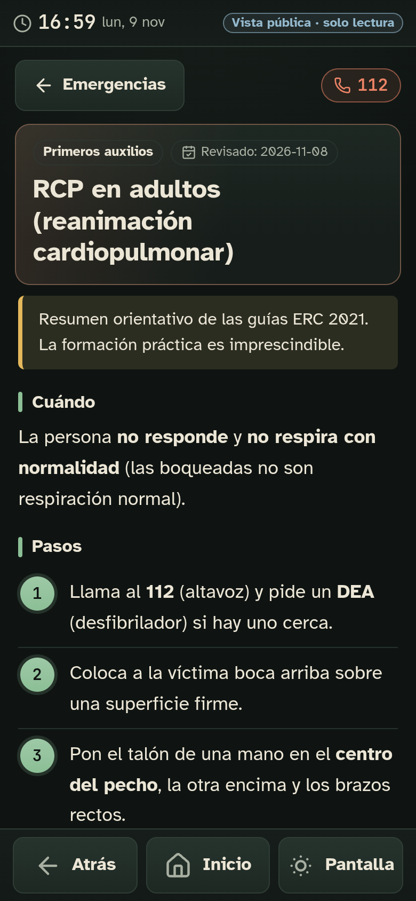</td>
</tr></table>

### Encrypted vault

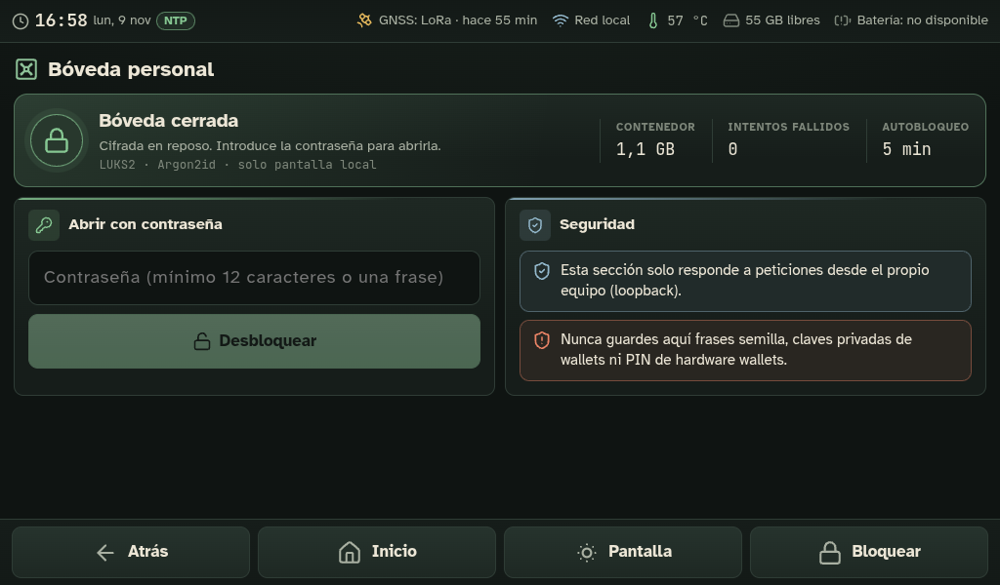

- For personal documents: copies of ID cards, prescriptions, contacts, passwords…
- **Encryption:**
  - **on the Pi**, a LUKS2 container with Argon2id, managed by a sandboxed service with no network access;
  - **in the portable version**, Argon2id and AES-256-GCM, and nothing is ever stored in plain text on disk.
- **Password or PIN** (a PIN of 4 digits or more is accepted on a personal device), plus a **recovery key** so you
  don't lose your documents if you forget the password.
- **Protection:**
  - it only responds to the local screen;
  - it locks itself after inactivity;
  - each failed attempt increases the wait.
- Image viewer with touch zoom, renaming and import from USB.

### Field tools and games

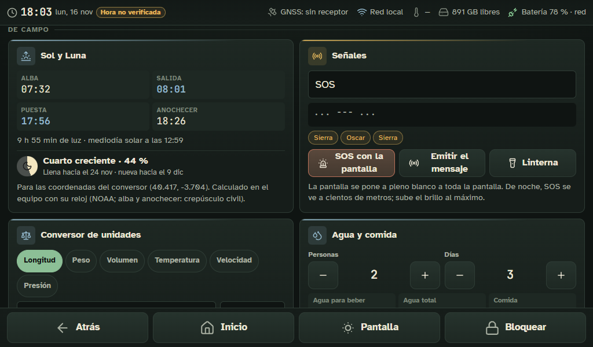

Everything is computed on the device itself and each tool cites its source.

- **Sun and Moon:** dawn, sunrise, sunset and dusk (civil twilight), daylight hours, solar noon and the Moon phase
  with the next full and new moons. Uses the GNSS position, the LoRa node's position or coordinates you type in
  (NOAA algorithm).
- **Signals:** the screen as a **flashlight** or to send **SOS** or any message in **Morse** (ITU timings), with the
  Morse text visible. At night, the SOS is visible hundreds of metres away.
- **Emergency frequencies**, with their source and whether they need a licence: marine VHF channel 16, aviation,
  distress beacons, CB (channels 9 and 19), PMR446, amateur radio (2 m, 70 cm, HF), Meshtastic, FRS and GMRS.
- **Water and food:** how much water (drinking and total) and how many kcal you need for a number of people and
  days, using the **Sphere Handbook** minimums.
- **Unit converter:** length, weight, volume, temperature, speed and pressure.
- **Coordinates:** from decimal to degrees, minutes and seconds.
- **Equipment:** connected USB serial ports and input devices.
- **Offline games:** a collection of games downloaded with "Download everything" or from Maintenance. The "Games"
  button appears in the bar (between Home and Display) only once they are downloaded.

### System and maintenance

<table><tr>
<td>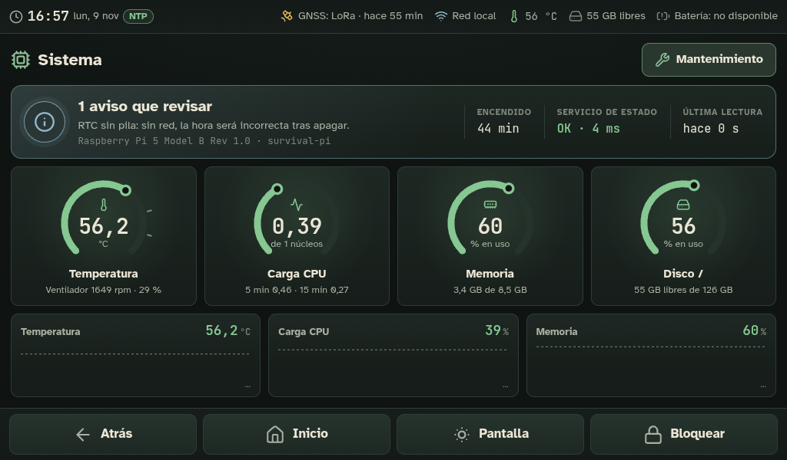</td>
<td>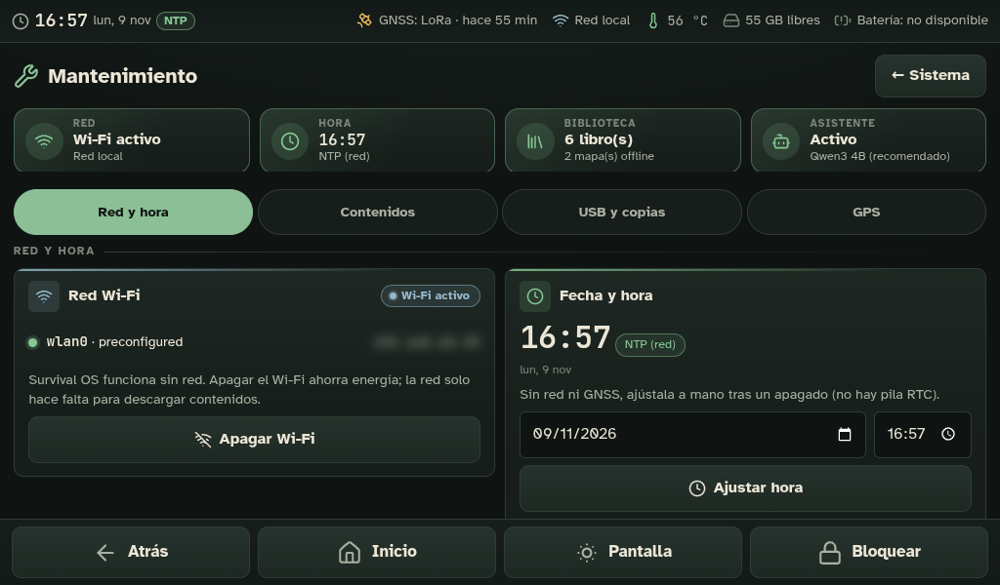</td>
</tr></table>

- **Device status**, with history:
  - temperature, fan, CPU, memory and disk;
  - power or battery (including the Pi's UPS and the laptop battery);
  - microSD health;
  - services.
- **Backup time without the Internet (Pi).** The Pi has no clock battery, so it corrects its time with GPS or LoRa
  node time; over LoRa it requires two matching samples. Tested: with the clock deliberately set 1 h behind, it ended
  up 0.2 s from the real time.
- **Maintenance**, with the same sections on the Pi and in the portable version:
  - **Network and time:** on the Pi, Wi-Fi is switched on and off and the time is set; in the portable version the
    operating system manages them and they are only displayed.
  - **Content:** "Download everything", the full catalogue and the status of each download.
  - **USB and backups:** import maps and documents, backups and updates.
  - **GPS:** over GPIO on the Pi, over USB in the portable version.
- **Display:**
  - language;
  - high contrast and large text;
  - on-screen keyboard and dimming;
  - safe lock, restart and shutdown.

## Languages and country

Survivelia OS is fully available in **Spanish, English, French and Italian**:

- **Interface** (over 900 strings), dates, numbers, map names and on-screen keyboard:
  - Spanish: QWERTY with ñ;
  - French: AZERTY with ç;
  - English and Italian: QWERTY;
  - in each language, its own accent keys.
- **Emergency protocols**, the printable guide, the download catalogue and system messages.
- **The assistant** answers in the language of the question.

**Changing the language:** on the welcome screen or in **Display** (languages icon, at the very top).

**How content is chosen.**

- **Library:** for each topic (Wikipedia, Wikivoyage, iFixit…) the version in your language is chosen; if there is
  none, the English one. Never a language you have not chosen.
- **Maps:** your country's and the world map.
- **Maintenance:** only shows content in your languages; a switch reveals the rest.

**The country** is detected without the Internet or any external service. In order:

1. the GPS position;
2. the LoRa node's position;
3. the system time zone;
4. the browser language.

If it cannot be detected, Spain is used with the interface in Spanish. You can always choose another.

## Downloadable content

Everything is managed in **System → Maintenance → Content** (or from the welcome screen):

| Group | Examples | Languages |
|---|---|---|
| Health and first aid | Medical Wikipedia, MedlinePlus, medicine libraries | es · en · fr · it |
| Preparedness and survival | Ready.gov, libraries on water, food and knots, military manuals | es · en · it |
| Encyclopedias and reference | Wikipedia, Wiktionary, Wikivoyage, Wikisource | es · en · fr · it |
| Repair and trades | iFixit, Low-tech Lab, Appropedia, DIY and mechanics forums | es · en · fr · it |
| Books and learning | Project Gutenberg, Wikibooks, Wikiversity, PhET simulations | es · en · fr · it |
| PDF manuals | 66 manuals on health, civil protection, agriculture and navigation | es · en |
| Maps and routing | Any country, world, BRouter routing | all |
| Assistant | Qwen3 4B (recommended), Gemma 3 4B, Llama 3.2 3B; Qwen2.5 1.5B for low RAM | all |
| Games | Collection of offline games (about 1.6 GB) | all |

- **How much space:** the recommended content for one language adds up to about **40–60 GB**, plus your country's
  maps (all of Spain: about 4.5 GB with routing). It fits comfortably on a 128 GB card; if there is not enough space,
  the selection adjusts itself, dropping the least essential items first.
- **Integrity:** everything is downloaded from the official source (Kiwix, Protomaps, Hugging Face, each manual's
  publisher) and verified with SHA-256. The components for each system (Kiwix, llama.cpp, Java, BRouter) are picked
  automatically for the operating system and processor.
- **Without the Internet:** you can also copy maps (`.pmtiles`), documents or Wikipedia (`.zim`) from a USB drive or,
  in the portable version, straight into its `data/` folder.

Sources and licences are listed in [docs/content-sources.md](docs/content-sources.md) (in Spanish).

## Updates, backups and USB

### Automatic updates

Survivelia OS updates itself from the [published releases](https://github.com/crazyramirez/Survivelia-OS/releases) on
GitHub, on the Pi, the portable version and Android: **System → Maintenance → Network and time → "Updates"**.

- Shows the installed and latest versions, with the **release notes in your language**, and flags a new version in
  the status bar. "Check now" and "Install" manually whenever you want.
- **Checks when you open the app and when you return to it**, if there is Internet (at most every 10 minutes).
- **Three modes:**
  - **Automatic** (the portable default): downloads by itself and applies the update **when you close** Survivelia OS,
    without interrupting you;
  - **Notify only** (the Pi and Android default): notifies you and installs with one tap. On the Pi, "Automatic"
    installs between 02:00 and 06:00 and only with the vault locked;
  - **Off**.
- **Security:** only installs **signed** releases (Ed25519), checks the size and SHA-256 of the download and never
  downgrades.
- **Automatic rollback** (Pi and portable): the new version starts on probation; if it does not respond, it reverts to
  the previous one by itself. Your data is not touched.

Details in [ADR 0021](docs/adr/0021-actualizaciones-github.md) (in Spanish).

### USB and backups

Everything from **System → Maintenance → USB and backups**, the same on the Pi and in the portable version.

**Scan USB.** Detects connected USB drives and disks and lists what can be used:

- maps, documents and Survivelia OS updates;
- on Windows, external USB disks too; never the computer's internal disks.

**Import.**

- **Maps** (`.pmtiles`, version 3): installed with one tap.
- **Documents:** pick several at once and the library indexes them for search.

**Backup.** Copies to the chosen drive:

- your points and tracks, your documents, the settings and the **vault (always encrypted)**;
- maps and Wikipedia only if you tick them, because they are large and can be downloaded again.

When finished, the backup is verified file by file (SHA-256) and includes instructions for restoring it.

**Updating without the Internet.** Copy the new version to a USB drive together with its `.sha256` file:

| Version | File |
|---|---|
| Pi | `survival-os-X.Y.Z.tar.gz` |
| Portable | `survival-os-X.Y.Z-portable.zip` |
| Android | `survival-os-X.Y.Z-android-arm64.apk` |

Scan the USB drive and press **Update**. It is verified before installing and the app restarts by itself with the new
version:

- your data is not touched;
- the previous version is kept so you can roll back;
- if something fails, the previous version stays.

## Hardware

| Part | Use |
|---|---|
| Raspberry Pi 5 (8 GB) | Main device (tested with 8 GB) |
| 7" 1024×600 HDMI touch screen | Kiosk-mode interface (Wayland/labwc) |
| microSD or SSD of 128 GB or more | System, library, maps and AI models |
| UPS for Pi 5 *(optional)* | Runtime on battery and power-cut warning (tested with Geekworm X1202) |
| 2 × Heltec WiFi LoRa 32 V4 *(optional)* | Meshtastic mesh: base node + pocket node |
| GNSS module for the base node *(optional)* | Position and time without the Internet. Must sit 1–2 m from the Pi: the Pi 5 interferes with the GPS band |
| USB GPS *(optional)* | Detected automatically (Pi and portable) |
| ESP32 over USB *(optional)* | Your own sensors ([example firmware](firmware/)), on the Pi and in the portable version |

The portable version works with whatever computer you have. 8 GB of RAM is recommended for the assistant.

## For developers

### Structure

```text
apps/frontend/           Nuxt 4 (SPA) + Nitro server: interface, API and proxy to the local services
services/device-api/     Device status (sysfs, /proc, vcgencmd, nmcli, systemctl; laptop battery)
services/library/        Protocols per language, FTS5 search, notes, place search (PMTiles), Kiwix gateway, assistant (RAG + llama.cpp)
services/navigation/     gpsd client, points, GPX tracks, LoRa fallback position
services/vault/          Vault: LUKS2 on the Pi; Argon2id + AES-GCM in the portable version
services/serial-hub/     Portable: Meshtastic, GPS (gpsd-compatible server) and ESP32 over USB, in Node
services/mesh/           Pi: Meshtastic gateway (Python)
services/esp32-gateway/  Pi: ESP32 over USB serial (JSON Lines v1)
content/                 Download catalogue, translations, countries and 41 protocols (es/en/fr/it)
portable/                Launcher, local installation and updates for the portable version
scripts/                 Installation, maintenance jobs, download engine, routing, backup time…
systemd/                 Sandboxed survival-* services (IPAddressDeny, ProtectSystem…)
docs/                    Architecture, security, hardware, commissioning and decisions (ADR)
```

Each service listens only on the device itself, with minimal permissions. Details are in the
[security model](docs/security-model.md) and the [architecture decisions](docs/adr/) (in Spanish).

### Commands

```sh
npm install
node scripts/fetch-map-assets.mjs     # map fonts and icons (once per clone)
npm run dev                           # services + interface at http://127.0.0.1:3000
npm run check                         # lint + types + tests (required before publishing)
npx vitest run --pool=vmThreads       # tests only (with Node 26, use this pool)
npm run e2e -- http://127.0.0.1:3000  # screen tests over CDP (1024×600, touch)
npm run guide                         # emergency guide as PDF (A5 and A4) in docs/
node scripts/build-countries.mjs      # regenerate content/countries.json (Natural Earth + IANA)
```

On Windows or macOS, during development, many device probes answer "unavailable (Linux only)". That is correct: the
interface shows honest empty states. To see real data, use the Pi or the portable version.

### Build the portable version

```sh
npm run build && npm run release:portable                        # all five systems
npm run release:portable -- --targets=win-x64,darwin-arm64       # only some
```

The result:

- `release/portable/Survivelia OS/`, the folder ready to use;
- `release/survival-os-X.Y.Z-portable.zip`, with its `.sha256`.

The zip keeps the execute permissions for macOS and Linux. More details in ADRs
[0014](docs/adr/0014-version-portable.md), [0015](docs/adr/0015-motor-de-descargas.md) and
[0016](docs/adr/0016-portable-paridad.md) (in Spanish).

### Build the Android app

You need JDK 17 or later, the Android SDK (platform 36), the NDK and Go 1.25 or later. The script looks for them in
`JAVA_HOME` and `ANDROID_HOME`, or in the per-user installation on Windows.

```sh
npm run build && npm run release:android                 # signed APKs: arm64 (tablets) and x86_64 (emulator)
npm run release:android -- --debug --abi=x86_64          # debug APK for the emulator
node android/scripts/natives.mjs [--abi=arm64-v8a] [--update-lock]   # native binaries only
```

The result is `release/survival-os-X.Y.Z-android-arm64.apk` and `-x86_64.apk`, with their `.sha256`.

- **Native binaries:**
  - Node 24 and kiwix-tools: Termux packages;
  - llama.cpp and pdftotext: built with the NDK;
  - pmtiles: built for Android with Go;
  - BRouter: its jar.

  Versions are pinned in `android/natives.lock.json`.
- **The first release build creates the signing key** in `.data/android-keystore.jks`. Keep it safe: without it you
  cannot update the installed app.

More details in [ADR 0020](docs/adr/0020-app-android.md) (in Spanish).

### Adding strings or protocols

- **Interface strings:** in `apps/frontend/app/locales/es.ts` and the same key in `en.ts`, `fr.ts` and `it.ts`. A
  test fails if any is missing or if a `{x}` placeholder changes.
- **Protocols:** in `content/protocols/` (Spanish, the reviewed original) and their translation in
  `content/protocols/<language>/`.

More details in [ADR 0017](docs/adr/0017-idiomas.md) (in Spanish).

## Status

**v0.11.0.** Runs on a real Raspberry Pi 5 and in the portable version for Windows.

- **Verified on the Pi:** kiosk, maps, routing, library, PDF viewer, assistant, vault, LoRa mesh, backup time and
  languages.
- **Verified on Windows (portable):**
  - assistant, vault, maps, routing and downloads;
  - backups, import and update, tested with the real portable build.
- **Verified on the Android emulator** (tablet, Android 16): startup, permissions, downloads, maps, routing,
  Wikipedia, assistant, GNSS and the loopback guard.
- **Automated tests:** 358, plus screen tests on desktop and mobile.

**Still to be tested:**

- macOS, for lack of hardware;
- the Android app on a physical tablet (USB OTG with LoRa and GPS, performance on arm64);
- LoRa, GPS and ESP32 on Windows and macOS, for lack of connected hardware;
- battery runtime;
- the hotspot with several phones at once;
- the real radio range in the field.

The [CHANGELOG](CHANGELOG.md) details each version.

> **Disclaimer:** the emergency protocols are a guidance summary and **do not replace training or professional
> medical care**. In an emergency, call your local emergency number (112 in Europe).

## Documentation

All in Spanish: [Architecture](docs/architecture.md) · [Security](docs/security-model.md) ·
[Hardware](docs/hardware-inventory.md) · [Commissioning](docs/commissioning.md) · [Field guide](docs/field-guide.md) ·
[Power](docs/power-tests.md) · [Sources and licences](docs/content-sources.md) · [UI design](docs/ui-design.md) ·
[ADR](docs/adr/)
