<p align="center">
  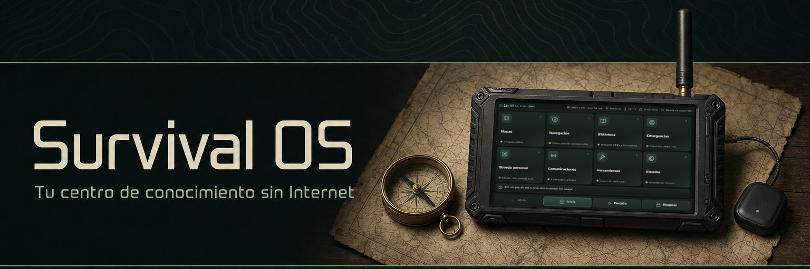
</p>

<p align="center">
  
  
  
  
  
  
</p>

<p align="center"><b>Español</b> · <a href="README.en.md">English</a></p>

# Survivelia OS

> 🤖 **Instálalo con tu asistente de IA:** clona este repositorio, ábrelo con Claude Code, Codex o Gemini y pídele
> «Instala Survivelia OS en mi Raspberry Pi» (o «en este ordenador»): él lo instala y configura todo, y solo te
> pregunta lo necesario. [Cómo hacerlo](#instalación-exprés-pídeselo-a-tu-asistente-de-ia).

**Un centro de conocimiento, mapas y comunicación que funciona sin Internet.** Mapas de cualquier país con rutas,
buscador de lugares, la Wikipedia, 41 protocolos de emergencia, cientos de manuales, un asistente de IA local,
herramientas de campo (Sol y Luna, señales SOS, frecuencias de emergencia, raciones), notas y listas, mensajería por
radio LoRa y una bóveda cifrada, en español, inglés, francés, italiano, alemán, chino o japonés. Se actualiza solo con versiones firmadas.

Funciona de tres maneras:

- como **terminal dedicado** en una Raspberry Pi 5 con pantalla táctil;
- como **aplicación portable** en Windows, macOS o Linux, desde una memoria USB o instalada en el ordenador;
- como **app de Android** (APK) en una tablet o un móvil.

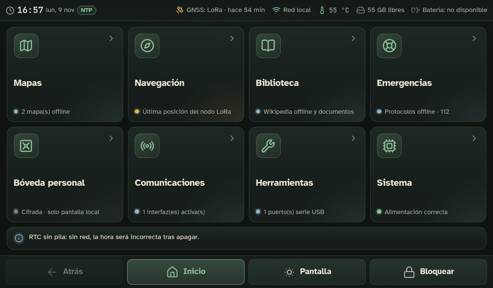

> Capturas reales del equipo (Raspberry Pi 5, 8 GB, pantalla 1024×600) con datos reales. En las capturas el mapa
> está centrado en Madrid y las direcciones de red aparecen difuminadas.

## Contenido

- [Qué es](#qué-es)
- [Instalación exprés: pídeselo a tu asistente de IA](#instalación-exprés-pídeselo-a-tu-asistente-de-ia)
- [Elige cómo usarlo](#elige-cómo-usarlo)
- [Empezar con la versión portable](#empezar-con-la-versión-portable)
- [Empezar en una Raspberry Pi](#empezar-en-una-raspberry-pi)
- [Empezar en Android](#empezar-en-android)
- [La primera vez: configurarlo todo con un clic](#la-primera-vez-configurarlo-todo-con-un-clic)
- [Funciones](#funciones)
- [Idiomas y país](#idiomas-y-país)
- [Contenidos que se pueden descargar](#contenidos-que-se-pueden-descargar)
- [Actualizar, copias de seguridad y USB](#actualizar-copias-de-seguridad-y-usb)
- [Hardware](#hardware)
- [Para desarrolladores](#para-desarrolladores)
- [Estado](#estado)
- [Documentación](#documentación)

## Qué es

Survivelia OS es una herramienta de consulta y comunicación para cuando no hay Internet: un apagón largo, una zona sin
cobertura, una salida al monte o una emergencia. Todo lo que necesita se descarga una vez y queda en el propio
equipo.

- **Sin conexión de verdad.** Después de descargar los contenidos, nada sale del equipo: ni CDN, ni fuentes, ni APIs
  remotas. Una política CSP lo bloquea y `test-offline.sh` lo comprueba.
- **Datos honestos.** Si algo no se puede medir, la pantalla dice «no disponible» y por qué; nunca muestra un valor
  inventado. Cuando un dato es estimado o viene de otra fuente (por ejemplo, la posición de un nodo LoRa de hace 7
  días), también lo dice.
- **Pensado para el dedo.** Botones grandes, barra de acciones siempre visible, modo noche y teclado en pantalla
  propio. En la Pi arranca directamente en modo quiosco.
- **Privado.** La interfaz solo escucha en el propio equipo. La bóveda y el asistente nunca son accesibles desde la
  red.

## Instalación exprés: pídeselo a tu asistente de IA

Este repositorio está preparado para que **un asistente de IA lo instale y configure por ti, en lenguaje natural**.
Tú solo contestas a sus preguntas: dónde lo quieres, la IP y el usuario de tu Raspberry Pi, el idioma y el país.

Con **[Claude Code](https://claude.com/claude-code)**, **[OpenAI Codex CLI](https://github.com/openai/codex)** o
**[Gemini CLI](https://github.com/google-gemini/gemini-cli)** instalado:

```sh
git clone https://github.com/crazyramirez/Survivelia-OS.git
cd Survivelia-OS
claude "Instala Survivelia OS en mi Raspberry Pi y descárgalo todo en español"
```

Con Codex o Gemini es igual; cambia solo la última línea:

```sh
codex "Instálame la versión portable de Survivelia OS en este ordenador"
gemini -i "Configura Survivelia OS en francés para Francia y descarga todo"
```

**Lo que el asistente sabe hacer** (las instrucciones están en [AGENTS.md](AGENTS.md)):

- **Raspberry Pi o Linux:**
  - te guía para preparar la tarjeta con Raspberry Pi Imager y encontrar la IP;
  - configura el acceso SSH; la contraseña solo la escribes tú y una vez;
  - descarga la última versión publicada (firma verificada), la instala, comprueba y reinicia en modo quiosco;
  - también si el asistente funciona en la propia Pi, sin SSH.
- **Versión portable:** la descarga para tu sistema (Windows, macOS o Linux) o para todos a la vez, la copia donde
  digas (también a un USB) y la abre o la instala con acceso directo.
- **Android:** descarga el APK, lo instala por cable con `adb` y abre la app; sin cable, te lo deja listo para copiar.
- **Configuración:** idioma, país, «Descargarlo todo» (con su progreso), estado del equipo y actualizaciones.
- **Seguridad:** antes de instalar o de lanzar descargas grandes te dice qué va a hacer y espera tu confirmación.
  Nunca guarda contraseñas.

**¿Sin asistente de IA?** Los mismos pasos, con un solo comando (requiere [Node](https://nodejs.org); `--release` descarga
la versión publicada, sin compilar):

```sh
npm run express -- doctor                                         # qué falta en este ordenador
npm run express -- portable --release                             # versión portable para este ordenador, lista y abierta
npm run express -- pi --host 192.168.1.50 --user pi --release --yes --reboot  # instalar en una Raspberry Pi por SSH
npm run express -- android --release --yes                        # instalar en la tablet conectada por USB
npm run express -- download --host 192.168.1.50 --user pi --yes   # «Descargarlo todo» en la Pi
npm run express -- update --host 192.168.1.50 --user pi --check   # ¿hay versión nueva?
```

Cambia la IP y el usuario por los de tu Pi. Todas las opciones están al principio de
[scripts/express.mjs](scripts/express.mjs).

## Elige cómo usarlo

| | **Portable** (Windows, macOS, Linux) | **Raspberry Pi 5** (terminal dedicado) | **Android** (tablet o móvil) |
|---|---|---|---|
| Para quién | Probarlo en minutos, llevarlo en un USB o usarlo en tu ordenador | Un equipo de supervivencia propio, siempre listo | Una tablet con batería, GPS y pantalla táctil que ya tienes |
| Instalación | Descomprimir una carpeta y abrirla; nada que instalar | Instalar Survivelia OS en Raspberry Pi OS (unos minutos) | Instalar el APK y aceptar los permisos |
| Pantalla | Una ventana en tu ordenador | Pantalla táctil a pantalla completa (quiosco) | A pantalla completa; se puede fijar (quiosco) |
| Funciones | Todas: mapas, biblioteca, asistente, LoRa y GPS por USB, bóveda, juegos | Todas, más el punto de acceso Wi-Fi propio, la hora de respaldo por GPS/LoRa y el control de la Wi-Fi | Todas, con el GPS y la batería de la tablet; LoRa y GPS por USB OTG |
| Dónde viven tus datos | En la carpeta `data/` de la propia app | En `/var/lib/survival-os` | En la carpeta `SurvivalOS` (memoria interna o microSD) |

Las tres versiones comparten el mismo código y la misma interfaz: lo que aprendas en una sirve en las otras.

## Empezar con la versión portable

### 1. Consigue la carpeta

La versión portable es una carpeta llamada **«Survivelia OS»** (unos 590 MB; comprimida, unos 210 MB). Trae todo lo
necesario para los cinco sistemas, Node incluido: no hay que instalar nada antes.

- **Descárgala** de la [última versión publicada](https://github.com/crazyramirez/Survivelia-OS/releases/latest)
  (`survival-os-X.Y.Z-portable.zip`) y descomprímela donde quieras: memoria USB (mejor en exFAT), disco externo o
  tu carpeta de usuario. Para una memoria USB perfecta (icono, nombre, «abrir al conectar»), ábrela y usa
  Sistema → Mantenimiento → **Memoria USB** → «Preparar una memoria USB».
- **Si partes del código:** sigue [Generar la versión portable](#generar-la-versión-portable) en la sección para
  desarrolladores; el resultado queda en `release/portable/Survivelia OS/`.

### 2. Ábrela

| Sistema | Cómo abrir |
|---|---|
| **Windows 10/11** (x64) | Doble clic en **«Survivelia OS»** (el de la brújula) |
| **macOS 11 o posterior** (Apple Silicon e Intel) | Doble clic en **«Survivelia OS»**. La primera vez macOS puede bloquearla porque no está firmada: clic derecho → **Abrir** → **Abrir** |
| **Linux** x64 y arm64 (también Raspberry Pi OS de 64 bits) | Doble clic en **`abrir-survival-os.sh`** (Ejecutar) o, en una terminal, `sh abrir-survival-os.sh` |

Survivelia OS se abre en **una ventana propia** y al cerrarla se detiene. Funciona mejor si el ordenador tiene Chrome,
Edge, Brave o Chromium. Si no hay ninguno, se abre en el navegador predeterminado; en ese caso, para salir:
**Sistema → «Cerrar Survivelia OS»**.

> **Si macOS dice que la app «está dañada»:** abre Terminal y ejecuta
> `xattr -dr com.apple.quarantine "/ruta/a/Survivelia OS"`.
> **Si Linux no la ejecuta desde la memoria USB:** algunas distribuciones montan los USB sin permiso de ejecución;
> copia la carpeta a tu disco.

### 3. Sigue la bienvenida

La primera vez aparece la [bienvenida](#la-primera-vez-configurarlo-todo-con-un-clic): eliges idioma y país y, con
**un clic**, se descarga todo lo necesario. Hace falta Internet solo durante la descarga.

### Usarla desde el USB o instalarla en el ordenador

- **Desde el USB, sin instalar nada:** la app no modifica el sistema. Tus mapas, documentos y descargas se guardan en
  la carpeta `data/`, dentro de la propia carpeta, así que puedes llevarlo todo a otro ordenador.
- **Instalarla en este ordenador** (opcional): dentro de la app, **Sistema → Mantenimiento → «Instalar en este
  equipo»**. Copia la app y tus datos a la carpeta de aplicaciones del usuario y crea un acceso directo (menú Inicio
  y escritorio en Windows; Aplicaciones en macOS; menú de aplicaciones en Linux). No pide permisos de administrador.
- **Antes de retirar el USB:** cierra la ventana de Survivelia OS y espera unos segundos.
- **Desinstalar:** cierra la app y borra la carpeta (y el acceso directo, si la instalaste).
- **Si algo falla:** los registros están en `data/logs/`.

## Empezar en Android

Necesitas una tablet o un móvil con **Android 10 o posterior** (64 bits). Con 3–4 GB de RAM funciona todo; el
asistente usa entonces un modelo ligero.

1. **Instala el APK** `survival-os-X.Y.Z-android-arm64.apk`, que está en cada
   [versión publicada](https://github.com/crazyramirez/Survivelia-OS/releases/latest) junto a la portable y la de la
   Pi: ábrelo en la tablet (Android pedirá permitir «instalar apps desconocidas») o, desde un ordenador,
   `adb install`. Para generarlo desde el código, ver
   [Para desarrolladores](#para-desarrolladores).
2. **Elige dónde guardar los datos.** La carpeta **SurvivalOS** de la memoria interna o de la microSD se conserva
   aunque desinstales la app (pide «acceso a todos los archivos»).
3. **Acepta los permisos:**
   - notificaciones;
   - ubicación, para usar el GPS de la tablet sin Internet;
   - batería sin restricciones, para que las descargas, la radio y el GPS sigan con la pantalla apagada.
4. **Sigue la bienvenida**, como en las otras versiones.

- **Hardware:** la radio LoRa (Meshtastic), un GPS USB y las placas ESP32 se conectan con un cable OTG; al enchufarlos,
  Android ofrece abrir Survivelia OS.
- **Compartir con otros móviles:** activa el punto de acceso de la tablet y «Compartir en la red local».
- **Fijar la pantalla** (quiosco) y los permisos están en Mantenimiento → «Survivelia OS para Android».
- **En algunas marcas** (Realme, Xiaomi, Huawei…) activa también «Inicio automático» y «Actividad en segundo plano»
  en los ajustes de la app.
- **Si algo falla:** los registros están en `SurvivalOS/logs/`.

Detalles técnicos: [ADR 0020](docs/adr/0020-app-android.md).

## Empezar en una Raspberry Pi

### Qué necesitas

- Una **Raspberry Pi 5** (probada con 8 GB) con su fuente de alimentación.
- Una **microSD o SSD de 128 GB o más** con **Raspberry Pi OS (Bookworm, 64 bits) con escritorio**. La forma más
  fácil de prepararla es [Raspberry Pi Imager](https://www.raspberrypi.com/software/).
- Una pantalla (probada con una táctil HDMI de 7", 1024×600) y conexión a Internet para la instalación.
- Un ordenador con **Node 24.15 o posterior** para generar el paquete de instalación.

### Instalar

1. **En el ordenador**, genera el paquete:

   ```sh
   npm install
   node scripts/fetch-map-assets.mjs        # tipografías e iconos del mapa (solo la primera vez)
   npm run build && npm run release         # → release/survival-os-X.Y.Z.tar.gz
   ```

2. **Cópialo a la Pi** junto con el instalador (cambia `<usuario>` e `<IP>` por los de tu Pi):

   ```sh
   scp release/survival-os-*.tar.gz scripts/install-system.sh <usuario>@<IP>:/tmp/
   ```

3. **En la Pi**, instálalo:

   ```sh
   sudo bash /tmp/install-system.sh /tmp/survival-os-X.Y.Z.tar.gz
   ```

4. **Reinicia la Pi.** Arranca directamente en Survivelia OS, a pantalla completa, con la
   [bienvenida](#la-primera-vez-configurarlo-todo-con-un-clic).

El instalador:

- deja la aplicación en `/opt/survival-os` y crea el usuario de servicio `survival`;
- instala los servicios `survival-*`, cada uno aislado y escuchando solo en el propio equipo;
- activa el modo quiosco para el usuario de escritorio, que detecta solo;
- pone la **imagen de Survivelia OS** en lugar de la de Raspberry Pi: pantalla de arranque y apagado, fondo del
  escritorio y de la pantalla de acceso; quita además la pantalla arcoíris y los logos de frambuesa
  (`disable_splash=1` en `config.txt` y `logo.nologo` en `cmdline.txt`, con copia de seguridad);
- conserva la versión anterior para poder volver atrás.

Opciones: `--no-kiosk` (otro Linux, sin pantalla completa) y `--no-branding` (dejar la imagen de Raspberry Pi). Se
recuerdan para las actualizaciones; `--kiosk` y `--branding` las vuelven a activar. La imagen también se puede
aplicar o quitar sola: `sudo bash /opt/survival-os/current/scripts/pi-branding.sh` (o `--revert`; `--status` para
ver qué hay).

Para desinstalar: `sudo bash /opt/survival-os/current/scripts/uninstall-system.sh` (vuelve también a la imagen de
Raspberry Pi). La
[puesta en marcha](docs/commissioning.md) explica cada paso con más detalle (pantalla, táctil, GPS, LoRa).

## La primera vez: configurarlo todo con un clic

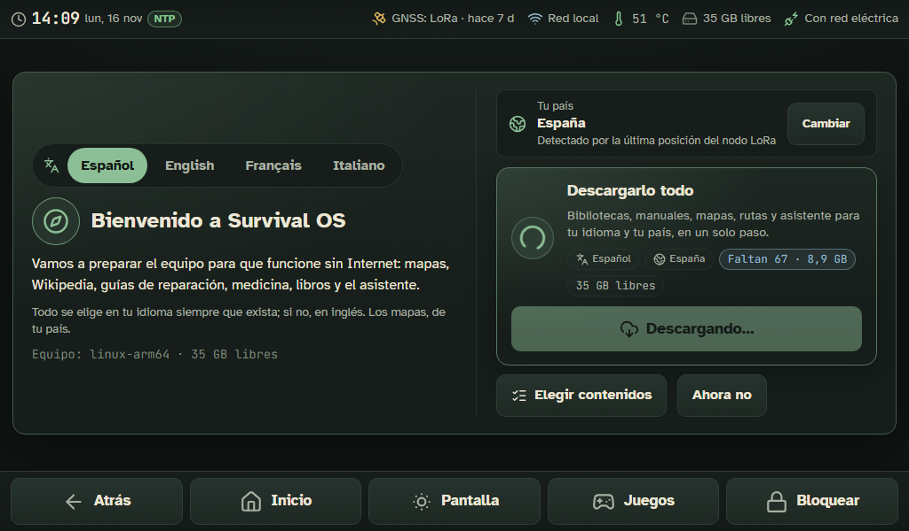

La bienvenida aparece una sola vez y cabe en una pantalla:

1. **Idioma.** Se propone el del equipo (navegador y zona horaria); se cambia tocando *Español*, *English*,
   *Français*, *Italiano*, *Deutsch*, *中文* o *日本語*.
2. **País.** Se detecta sin Internet, por la posición GNSS o la del nodo LoRa, si la hay, y si no por la zona horaria.
   La pantalla dice cómo lo ha detectado. «Cambiar» permite elegir cualquier otro.
3. **«Descargarlo todo».** Un clic descarga todo lo recomendado para tu idioma y tu país:
   - biblioteca, manuales, mapas y rutas;
   - el asistente con todos sus modelos;
   - los juegos.

   Se ajusta al espacio libre y avisa de lo que no cabe.

Mientras descarga **puedes usar el equipo**: lo que ya está instalado funciona desde el primer momento, y el
progreso se ve en la pantalla de inicio. Según tu conexión, el 100 % puede tardar horas. Si se corta la red o apagas
el equipo, al volver a lanzarlo **continúa donde se quedó**.

¿Prefieres elegir? **«Elegir contenidos»** muestra el catálogo completo por grupos, con todo lo recomendado ya
marcado. **«Ahora no»** deja la configuración para más tarde (Sistema → Mantenimiento → Contenidos).

## Funciones

### Emergencias: 41 protocolos y una guía para imprimir

<table><tr>
<td>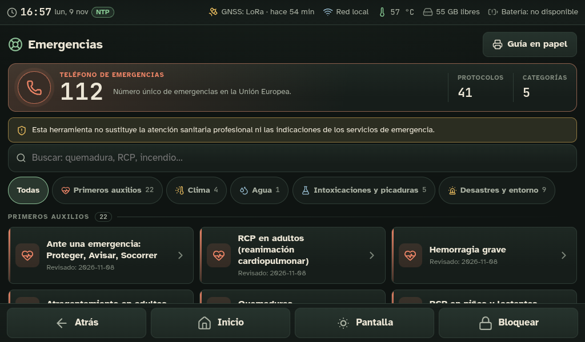</td>
<td>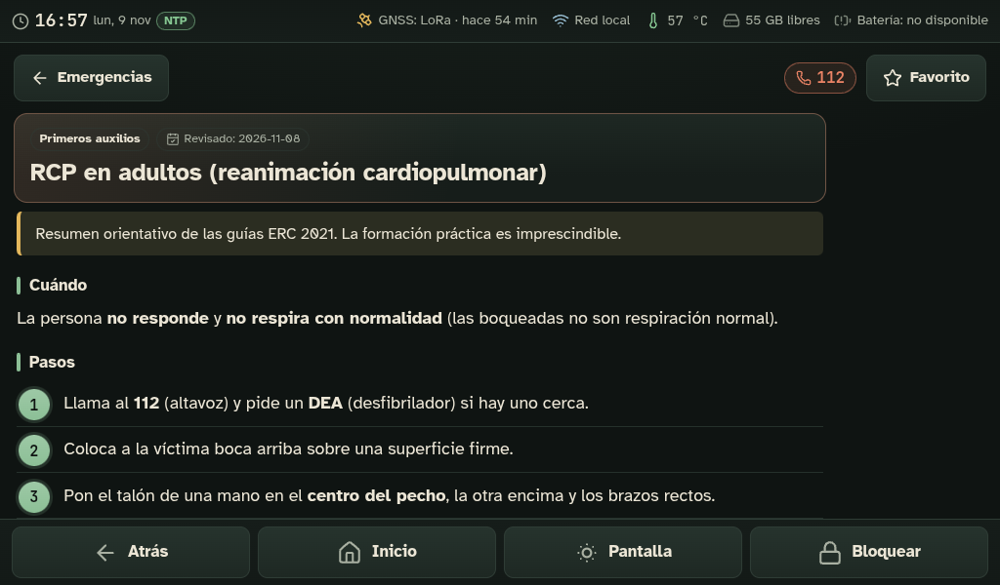</td>
</tr></table>

- **41 protocolos** en 5 categorías (primeros auxilios, clima, agua, intoxicaciones y picaduras, desastres y
  entorno): RCP, hemorragias, atragantamiento, quemaduras, hipotermia, golpe de calor, potabilización, incendios,
  inundaciones…
- Cada protocolo indica sus **fuentes y su fecha de revisión** (por ejemplo, las guías ERC 2021), con pasos
  numerados y avisos claros.
- Disponibles en **español, inglés, francés, italiano, alemán, chino y japonés**. Las traducciones conservan las mismas cifras y dosis
  (comprobado automáticamente) y avisan de que, ante la duda, prevalece el original en español.
- Búsqueda instantánea, favoritos y acceso directo al **112**.
- **Guía en papel:** desde Emergencias se imprime (o se guarda como PDF en un USB) una guía con todos los
  protocolos, en el idioma de la interfaz, para tenerla aunque el equipo se quede sin batería.

### Mapas de cualquier país, con rutas a pie, en bici y en coche

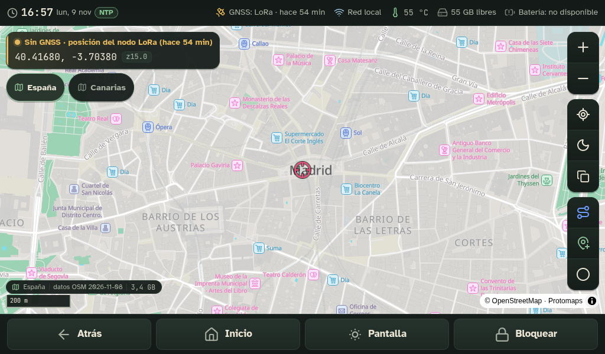

- **Cualquier país del mundo:** **«Añadir país»** (en Mapas o en Mantenimiento) busca entre 242 países por su nombre en
  cualquiera de los siete idiomas, muestra el tamaño aproximado y lo descarga con un toque.
  - **Detalle:** nivel de calle en países como España; algo menos en los muy grandes, para que quepan.
  - **Islas y territorios:** los cercanos van incluidos (Canarias con España, Alaska con EE. UU.); los de ultramar
    lejanos no se descargan.
- **España** tiene sus mapas ya preparados: península y Baleares (3,4 GB) y Canarias. Hay también un **mapa del
  mundo** general.
- **Rutas sin conexión** con [BRouter](https://github.com/abrensch/brouter), en el propio equipo, para cualquier
  país descargado:
  - perfiles a pie, en bici y en coche, con distancia, tiempo y desnivel;
  - exportación a GPX;
  - un paseo de 3 km se calcula en 0,1 s; Madrid → Sevilla (531 km), en 10,5 s, en la Pi.
- **Buscar un lugar sin conexión:** pueblos, barrios, aldeas y parajes de los mapas instalados, por su nombre y
  primero los más cercanos. Desde el resultado, **«Ruta hasta aquí»** o **«Guardar como punto»**. El índice se
  prepara solo a partir de los propios mapas y se rehace al añadir o quitar un país.
- **Medir distancia y área** tocando el mapa o con la mira del centro.
- **Nombres de lugares** en el idioma de la interfaz, y modo día y noche.
- **Puntos guardados** por tipo (agua, refugio, peligro…), grabación de tracks y coordenadas copiables.
- **Posición:**
  - GPS por USB o GNSS del nodo LoRa;
  - sin GPS propio, el mapa muestra la posición que llega por radio desde tu nodo Meshtastic, con su antigüedad y
    su precisión real.
- **Enlace directo a un punto:** `/mapas?lat=40.4168&lon=-3.7038&z=15`.

### Biblioteca: Wikipedia, guías y manuales, sin Internet

<table><tr>
<td>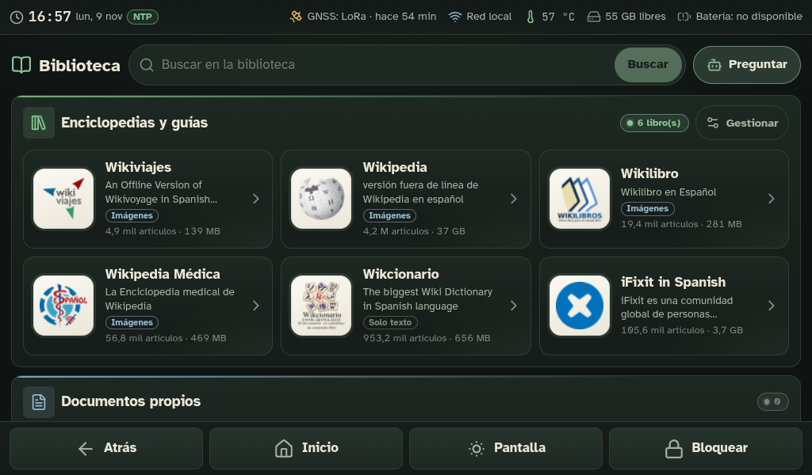</td>
<td>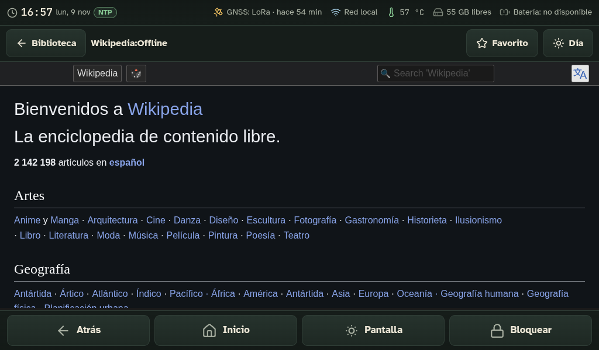</td>
</tr></table>

- **Enciclopedias y guías Kiwix**, con un lector integrado pensado para la pantalla táctil:
  - Wikipedia y Wikipedia médica;
  - Wikiviajes, Wikilibros, Wikcionario y Wikisource;
  - iFixit (guías de reparación);
  - MedlinePlus y bibliotecas de agua, medicina, alimentos y nudos;
  - foros de preguntas y respuestas de bricolaje, huerto, mecánica, radioaficionados y cocina.
- **66 manuales en PDF:**
  - salud: *Donde no hay doctor*, MSF, CICR, OMS;
  - Protección Civil;
  - agricultura (FAO);
  - orientación y supervivencia.

  Se descargan siempre de su fuente oficial, verificados con SHA-256, y **se busca dentro de ellos**.
- **Documentos propios** (PDF, Markdown, HTML, texto), importados desde un USB, con búsqueda de texto completo.
- **Notas, diario y listas** (Biblioteca → Notas): las líneas `- [ ]` son casillas que se marcan con un toque, hay
  plantillas de **kit de emergencia** (Ready.gov) y de **diario de incidencias**, y las notas aparecen en la búsqueda
  y como fuente del asistente. Se guardan sin cifrar; para datos sensibles, la bóveda.
- **Visores a todo el ancho:** documentos con tablas, código y citas, en modo día y noche.
- **Pantalla completa para leer:** en los PDF, los documentos, el lector de libros y las guías de emergencia, un botón
  deja solo el documento (sin barras); para salir, un botón flotante discreto, Escape o cambiar de pantalla.
- **Tamaño de letra** en el lector de libros y en los documentos de texto (del 80 al 200 %), al momento y sin perder
  por dónde se lee; se recuerda.
- **Visor de PDF propio:** con zoom (también pellizcando), modo noche y páginas que se cargan a medida que avanzas.
- **Nada saca al usuario de la app:** los enlaces a PDF o a ventanas nuevas se abren dentro, siempre con un botón
  para volver.
- Búsqueda unificada en todas las fuentes, favoritos y modo noche.

### Asistente de IA local

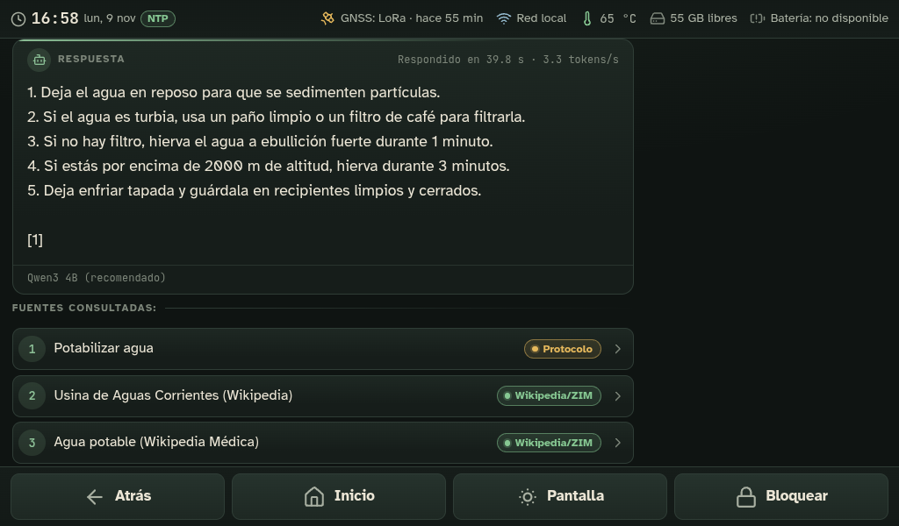

- Un modelo de lenguaje funcionando **en el propio equipo** (llama.cpp): Qwen3 4B, el recomendado; Gemma 3 4B y
  Llama 3.2 3B como alternativas. Ni la pregunta ni la respuesta salen del equipo.
- **A la medida de la memoria:** en equipos con poca RAM (tablets de 3–4 GB) no se proponen modelos que no caben y
  queda activo el **asistente ligero** (Qwen2.5 1.5B, 1,1 GB).
- **Responde con fuentes:** busca primero en los protocolos de emergencia, después en la biblioteca, en tus
  documentos y en tus notas, y **cita lo que ha consultado**. Si no lo encuentra, lo dice en lugar de inventar.
- Responde **en el idioma de quien pregunta**.
- **Rendimiento medido:**
  - en la Pi 5, unos 40–60 s por respuesta (≈ 3,5 tokens/s);
  - en un portátil moderno, mucho más rápido (≈ 18 tokens/s medidos en Windows).

### Comunicaciones: malla LoRa, punto de acceso y red local

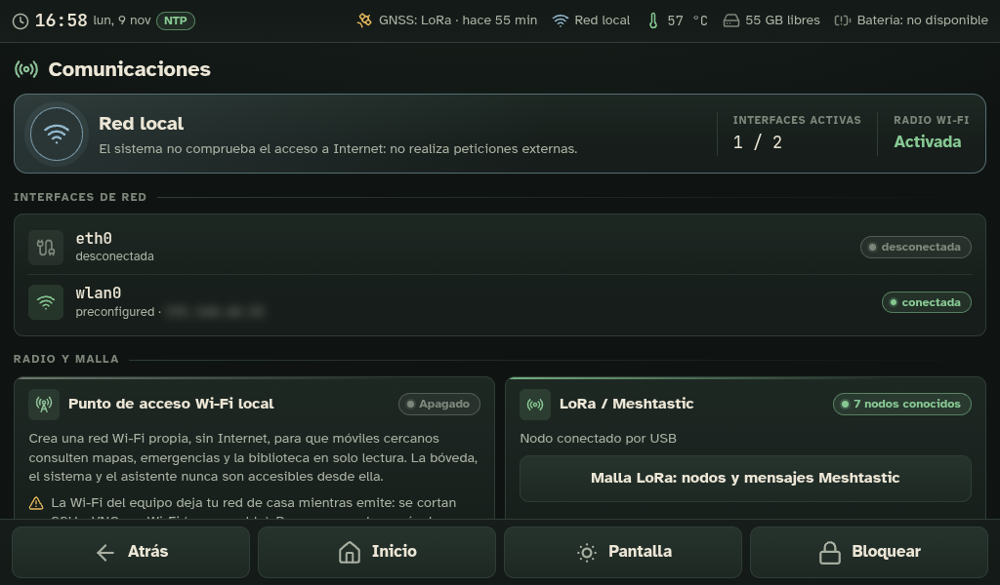

- **Mensajería por radio LoRa** (868 MHz) con nodos Meshtastic por USB:
  - nodos con batería, señal y saltos;
  - canales y mensajes, sin cobertura móvil;
  - se detectan solos al conectarlos, también en la versión portable.
- **Nodo base + nodo de bolsillo:** un nodo queda fijo en el equipo y otro va contigo, emparejado al móvil.
  - El equipo recibe tu posición **por radio, a kilómetros**, por un canal privado cifrado.
  - **«Pedir posición ahora»**, como mucho una vez por minuto, por el ciclo de trabajo de la banda.
- **Para que los móviles cercanos consulten mapas, emergencias y biblioteca en solo lectura y sin Internet:**
  - **En la Pi, punto de acceso Wi-Fi propio:** se enciende y apaga desde la pantalla, con portal cautivo; el móvil
    abre la app solo.
  - **En la portable, «Compartir en la red local»:** los móviles de la misma Wi-Fi hacen lo mismo.

<table><tr>
<td width="50%">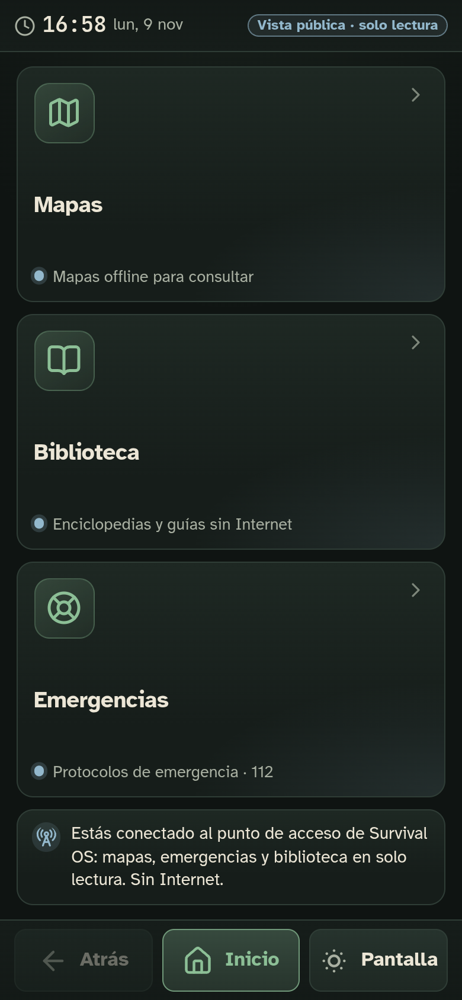</td>
<td width="50%">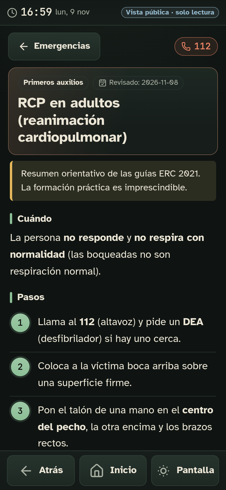</td>
</tr></table>

### Bóveda cifrada

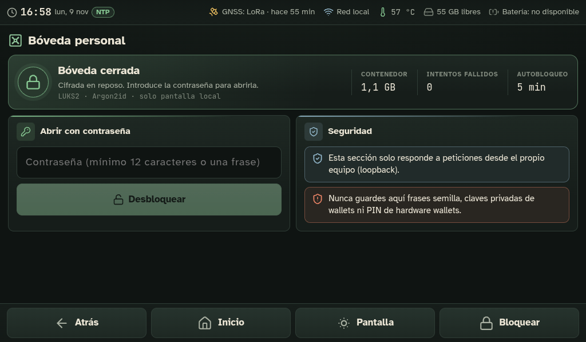

- Para documentos personales: copias de DNI, recetas, contactos, contraseñas…
- **Cifrado:**
  - **en la Pi**, un contenedor LUKS2 con Argon2id, gestionado por un servicio aislado y sin red;
  - **en la portable**, Argon2id y AES-256-GCM, y en el disco nunca hay nada en claro.
- **Contraseña o PIN** (un PIN de 4 cifras o más es válido en un equipo personal), más una **clave de recuperación**
  para no perder los documentos si olvidas la contraseña.
- **Protección:**
  - solo responde a la pantalla local;
  - se bloquea sola por inactividad;
  - tras cada intento fallido, la espera es mayor.
- Visor de imágenes con zoom táctil, renombrar e importar desde USB.

### Herramientas de campo y juegos

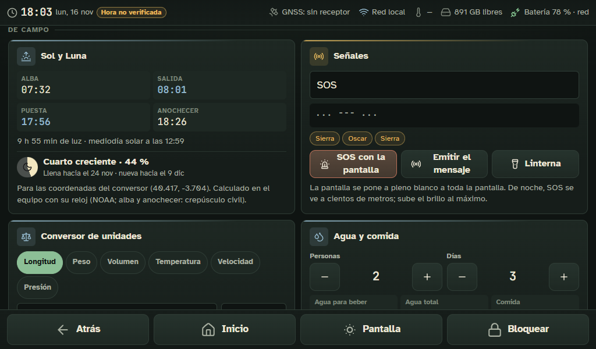

Todo se calcula en el propio equipo y cada herramienta cita su fuente.

- **Sol y Luna:** alba, salida, puesta y anochecer (crepúsculo civil), horas de luz, mediodía solar y fase de la
  Luna con las próximas llena y nueva. Usa la posición GNSS, la del nodo LoRa o las coordenadas que escribas
  (cálculo NOAA).
- **Señales:** la pantalla como **linterna** o para emitir **SOS** o cualquier mensaje en **Morse** (tiempos de la
  UIT), con el texto en Morse a la vista. De noche, el SOS se ve a cientos de metros.
- **Frecuencias de emergencia**, con su fuente y si piden licencia: VHF marina canal 16, aviación, radiobalizas,
  banda ciudadana (canales 9 y 19), PMR446, radioaficionados (2 m, 70 cm, HF), Meshtastic, FRS y GMRS.
- **Agua y comida:** cuánta agua (para beber y total) y cuántas kcal necesitáis según personas y días, con los
  mínimos del **Manual Esfera**.
- **Conversor de unidades:** longitud, peso, volumen, temperatura, velocidad y presión.
- **Coordenadas:** de decimal a grados, minutos y segundos.
- **Equipo:** puertos serie USB y dispositivos de entrada conectados.
- **Teclado Bluetooth en un toque** (Pi, Linux y portable en Linux): «Conectar teclado Bluetooth» busca sola, enseña
  primero teclados, ratones y mandos con su señal, y al elegir uno muestra en grande el código que hay que teclear
  (las cifras se iluminan al escribirlas). Queda de confianza y se reconecta solo; desde la misma tarjeta se reconecta
  o se desvincula. En Windows, macOS y Android abre los ajustes de Bluetooth del sistema.
- **Dirección del trackpad** (Pi): con un trackpad conectado se elige desplazamiento *natural* (como en el móvil) o
  *tradicional*; se aplica al momento.
- **Juegos sin conexión:** una colección de juegos que se descarga con «Descargarlo todo» o desde Mantenimiento.
  El botón «Juegos» aparece en la barra (entre Inicio y Pantalla) solo cuando ya están descargados.

### Sistema y mantenimiento

<table><tr>
<td>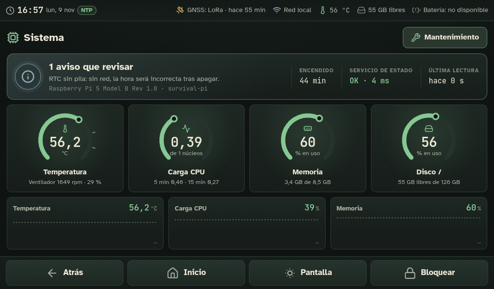</td>
<td>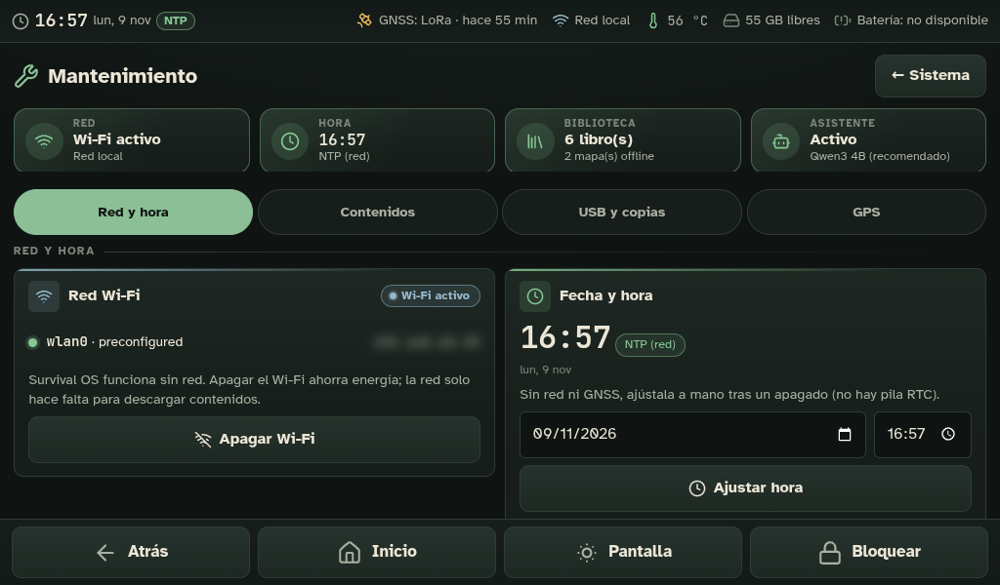</td>
</tr></table>

- **Estado del equipo**, con historial:
  - temperatura, ventilador, CPU, memoria y disco;
  - alimentación o batería (también la UPS de la Pi y la batería del portátil);
  - salud de la microSD;
  - servicios.
- **Hora de respaldo sin Internet (Pi).** La Pi no tiene pila de reloj, así que corrige su hora con la del GPS o la
  del nodo LoRa; por LoRa exige dos muestras coincidentes. Probado: con el reloj atrasado 1 h a propósito, quedó a
  0,2 s de la hora real.
- **Mantenimiento**, con las mismas secciones en la Pi y en la portable:
  - **Actualizaciones,** lo primero: estado, «Buscar ahora» / «Instalar» y el modo (automática, solo avisar,
    desactivada) en una tarjeta compacta.
  - **Contenidos:** «Descargarlo todo», el catálogo completo y el estado de cada descarga.
  - **Red, hora y USB:** en la Pi se apaga y enciende la Wi-Fi y se ajusta la hora (en la portable las gestiona el
    sistema operativo y solo se muestran); importar mapas y documentos desde un USB y hacer copias de seguridad.
  - **GPS:** por GPIO en la Pi, por USB en la portable.
- **Pantalla:**
  - idioma;
  - alto contraste y texto grande;
  - teclado en pantalla y atenuación;
  - bloqueo, reinicio y apagado seguros;
  - con la pantalla en ahorro, el toque que la enciende solo la enciende (no pulsa lo que haya debajo);
  - con ratón o trackpad, un puntero discreto con los colores de la app.

## Idiomas y país

Survivelia OS está completo en **español, inglés, francés, italiano, alemán, chino (simplificado) y japonés**:

- **Interfaz** (más de 1.500 textos), fechas, números, nombres del mapa y teclado en pantalla:
  - español: QWERTY con ñ;
  - francés: AZERTY con ç;
  - alemán: QWERTZ con ä, ö, ü y ß;
  - inglés e italiano: QWERTY;
  - en cada idioma, sus teclas de acento.
  - chino y japonés: el teclado en pantalla escribe letras latinas (pinyin, rōmaji, nombres); para escribir en
    caracteres chinos o japoneses hace falta un teclado físico con el método de entrada del sistema.
- **Protocolos de emergencia**, la guía imprimible, el catálogo de descargas y los mensajes del sistema.
- **El asistente** responde en el idioma de quien pregunta (en chino y japonés, la búsqueda en la biblioteca parte el
  texto en pares de caracteres, como el buscador de Kiwix).
- **Descargas propias de cada idioma:** Wikipedia (completa y médica), Wikcionario, Wikiviajes, Wikisource, iFixit,
  Wikilibros, Proyecto Gutenberg, Wikiversidad y PhET, en cada idioma donde Kiwix las publica.
- **Traducciones con IA:** la interfaz y los protocolos en alemán, chino y japonés (como en inglés, francés e
  italiano) se tradujeron con IA y no han pasado revisión nativa ni sanitaria; ante la duda, prevalece el original
  en español.

**Cambiar de idioma:** en la bienvenida o en **Pantalla** (icono de idiomas, arriba del todo).

**Cómo se eligen los contenidos.**

- **Biblioteca:** para cada tema (Wikipedia, Wikiviajes, iFixit…) se elige la versión en tu idioma; si no existe, en
  inglés. Nunca en un idioma que no hayas elegido.
- **Mapas:** los de tu país y el del mundo.
- **Mantenimiento:** solo muestra los contenidos de tus idiomas; un interruptor enseña los demás.

**El país** se detecta sin Internet ni servicios externos. Por orden:

1. la posición GPS;
2. la del nodo LoRa;
3. la zona horaria del sistema;
4. el idioma del navegador.

Si no se detecta, se usa España con la interfaz en español. Siempre se puede elegir otro.

## Contenidos que se pueden descargar

Todo se gestiona en **Sistema → Mantenimiento → Contenidos** (o con la bienvenida):

| Grupo | Ejemplos | Idiomas |
|---|---|---|
| Salud y primeros auxilios | Wikipedia médica, MedlinePlus, bibliotecas de medicina | es · en · fr · it |
| Preparación y supervivencia | Ready.gov, bibliotecas de agua, alimentos y nudos, manuales militares | es · en · it |
| Enciclopedias y referencia | Wikipedia, Wikcionario, Wikiviajes, Wikisource | es · en · fr · it |
| Reparación y oficios | iFixit, Low-tech Lab, Appropedia, foros de bricolaje y mecánica | es · en · fr · it |
| Libros y aprendizaje | Proyecto Gutenberg, Wikilibros, Wikiversidad, simulaciones PhET | es · en · fr · it |
| Manuales en PDF | 66 manuales de salud, protección civil, agricultura y orientación | es · en |
| Mapas y rutas | Cualquier país, mundo, rutas BRouter | todos |
| Asistente | Qwen3 4B (recomendado), Gemma 3 4B, Llama 3.2 3B; Qwen2.5 1.5B para poca RAM | todos |
| Juegos | Colección de juegos sin conexión (unos 1,6 GB) | todos |

- **Cuánto ocupa:** lo recomendado para un idioma suma unos **40–60 GB**, más los mapas de tu país (España completa:
  unos 4,5 GB con rutas). En una tarjeta de 128 GB cabe con holgura; si el espacio no llega, la selección se ajusta
  sola, quitando primero lo menos esencial.
- **Integridad:** todo se descarga de la fuente oficial (Kiwix, Protomaps, Hugging Face, los editores de cada
  manual) y se verifica con SHA-256. Los componentes de cada sistema (Kiwix, llama.cpp, Java, BRouter) se eligen
  solos según el sistema operativo y el procesador.
- **Sin Internet:** también puedes copiar mapas (`.pmtiles`), documentos o Wikipedia (`.zim`) desde un USB o, en la
  portable, directamente en su carpeta `data/`.

Las fuentes y sus licencias están en [docs/content-sources.md](docs/content-sources.md).

## Actualizar, copias de seguridad y USB

### Actualizaciones automáticas

Survivelia OS se actualiza solo desde las [versiones publicadas](https://github.com/crazyramirez/Survivelia-OS/releases)
en GitHub, en la Pi, la portable y Android: **Sistema → Mantenimiento**, la primera tarjeta («Actualizaciones»).

- Muestra la versión instalada y la última, con las **novedades en tu idioma**, y avisa en la barra de estado cuando
  hay una nueva. «Buscar ahora» e «Instalar» a mano cuando quieras.
- **Comprueba al abrir la app y al volver a ella**, si hay Internet (como mucho cada 10 minutos).
- **Tres modos:**
  - **Automática** (la de la portable): descarga sola y la aplica **al cerrar** Survivelia OS, sin interrumpir;
  - **Solo avisar** (la de la Pi y Android): avisa y se instala con un toque. En la Pi, «Automática» instala de
    02:00 a 06:00 y solo con la bóveda cerrada;
  - **Desactivada**.
- **Seguridad:** solo instala versiones **firmadas** (Ed25519), comprueba tamaño y SHA-256 de lo descargado y nunca
  baja de versión.
- **Vuelta atrás sola** (Pi y portable): la versión nueva arranca a prueba; si no responde, vuelve sola a la
  anterior. Tus datos no se tocan.

Detalles en el [ADR 0021](docs/adr/0021-actualizaciones-github.md).

### USB y copias

Todo desde **Sistema → Mantenimiento → USB y copias**, igual en la Pi y en la portable.

**Buscar en USB.** Detecta las memorias y discos USB conectados y lista lo que se puede usar:

- mapas, documentos y actualizaciones de Survivelia OS;
- en Windows, también los discos USB externos; nunca los internos del ordenador.

**Importar.**

- **Mapas** (`.pmtiles`, versión 3): se instalan con un toque.
- **Documentos:** se eligen varios a la vez y la biblioteca los indexa para la búsqueda.

**Copia de seguridad.** Copia a la memoria elegida:

- tus puntos y tracks, tus documentos, la configuración y la **bóveda (siempre cifrada)**;
- mapas y Wikipedia solo si lo marcas, porque son grandes y se pueden volver a descargar.

Al terminar, la copia se verifica fichero a fichero (SHA-256) e incluye instrucciones para restaurarla.

**Actualizar sin Internet.** Copia en un USB la versión nueva junto a su fichero `.sha256`:

| Versión | Fichero |
|---|---|
| Pi | `survival-os-X.Y.Z.tar.gz` |
| Portable | `survival-os-X.Y.Z-portable.zip` |
| Android | `survival-os-X.Y.Z-android-arm64.apk` |

Busca en el USB y pulsa **Actualizar**. Se verifica antes de instalar y la app se reinicia sola con la versión nueva:

- tus datos no se tocan;
- la versión anterior se guarda para poder volver atrás;
- si algo falla, se queda la versión anterior.

## Hardware

| Pieza | Uso |
|---|---|
| Raspberry Pi 5 (8 GB) | Equipo principal (probado con 8 GB) |
| Pantalla HDMI táctil 7" 1024×600 | Interfaz en modo quiosco (Wayland/labwc) |
| microSD o SSD de 128 GB o más | Sistema, biblioteca, mapas y modelos de IA |
| UPS para Pi 5 *(opcional)* | Autonomía y aviso de corte de corriente (probado con Geekworm X1202) |
| 2 × Heltec WiFi LoRa 32 V4 *(opcional)* | Malla Meshtastic: nodo base + nodo de bolsillo |
| Módulo GNSS para el nodo base *(opcional)* | Posición y hora sin Internet. Debe ir a 1–2 m de la Pi: la Pi 5 interfiere en la banda GPS |
| GPS USB *(opcional)* | Se detecta solo (Pi y portable) |
| ESP32 por USB *(opcional)* | Sensores propios ([firmware de ejemplo](firmware/)), en la Pi y en la portable |

La versión portable funciona con el ordenador que tengas. Para el asistente se recomiendan 8 GB de RAM.

## Para desarrolladores

### Estructura

```text
apps/frontend/           Nuxt 4 (SPA) + servidor Nitro: interfaz, API y proxy a los servicios locales
services/device-api/     Estado del equipo (sysfs, /proc, vcgencmd, nmcli, systemctl; batería del portátil)
services/library/        Protocolos por idioma, búsqueda FTS5, notas, buscador de lugares (PMTiles), pasarela Kiwix, asistente (RAG + llama.cpp)
services/navigation/     Cliente gpsd, puntos, tracks GPX, posición de respaldo LoRa
services/vault/          Bóveda: LUKS2 en la Pi; Argon2id + AES-GCM en la portable
services/serial-hub/     Portable: Meshtastic, GPS (servidor compatible con gpsd) y ESP32 por USB, en Node
services/mesh/           Pi: pasarela Meshtastic (Python)
services/esp32-gateway/  Pi: ESP32 por USB serie (JSON Lines v1)
content/                 Catálogo de descargas, traducciones, países y 41 protocolos (es/en/fr/it/de/zh/ja)
portable/                Lanzador, instalación en el equipo y actualización de la versión portable
scripts/                 Instalación, tareas de mantenimiento, motor de descargas, rutas, hora de respaldo…
systemd/                 Servicios survival-* aislados (IPAddressDeny, ProtectSystem…)
docs/                    Arquitectura, seguridad, hardware, puesta en marcha y decisiones (ADR)
```

Cada servicio escucha solo en el propio equipo y con permisos mínimos. Los detalles están en el
[modelo de seguridad](docs/security-model.md) y en las [decisiones de arquitectura](docs/adr/).

### Comandos

```sh
npm install
node scripts/fetch-map-assets.mjs     # tipografías e iconos del mapa (una vez por clon)
npm run dev                           # servicios + interfaz en http://127.0.0.1:3000
npm run check                         # lint + tipos + pruebas (obligatorio antes de publicar)
npx vitest run --pool=vmThreads       # solo las pruebas (con Node 26, usar este pool)
npm run e2e -- http://127.0.0.1:3000  # pruebas de pantalla por CDP (1024×600, táctil)
npm run guide                         # guía de emergencia en PDF (A5 y A4) en docs/
node scripts/build-countries.mjs      # regenerar content/countries.json (Natural Earth + IANA)
```

En Windows o macOS, durante el desarrollo, muchas sondas del equipo responden «no disponible (solo Linux)». Es lo
correcto: la interfaz muestra estados vacíos honestos. Para ver datos reales, usa la Pi o la versión portable.

### Generar la versión portable

```sh
npm run build && npm run release:portable                        # los cinco sistemas
npm run release:portable -- --targets=win-x64,darwin-arm64       # solo algunos
```

El resultado:

- `release/portable/Survivelia OS/`, la carpeta lista para usar;
- `release/survival-os-X.Y.Z-portable.zip`, con su `.sha256`.

El zip conserva los permisos de ejecución para macOS y Linux. Más detalles en los ADR
[0014](docs/adr/0014-version-portable.md), [0015](docs/adr/0015-motor-de-descargas.md) y
[0016](docs/adr/0016-portable-paridad.md).

### Generar la app Android

Necesitas JDK 17 o posterior, el Android SDK (plataforma 36), el NDK y Go 1.25 o posterior. El script los busca en `JAVA_HOME` y
`ANDROID_HOME`, o en la instalación por usuario de Windows.

```sh
npm run build && npm run release:android                 # APK firmados: arm64 (tablets) y x86_64 (emulador)
npm run release:android -- --debug --abi=x86_64          # APK de depuración para el emulador
node android/scripts/natives.mjs [--abi=arm64-v8a] [--update-lock]   # solo los binarios nativos
```

El resultado son los ficheros `release/survival-os-X.Y.Z-android-arm64.apk` y `-x86_64.apk`, con su `.sha256`.

- **Binarios nativos:**
  - Node 24 y kiwix-tools: paquetes de Termux;
  - llama.cpp y pdftotext: compilados con el NDK;
  - pmtiles: compilado para Android con Go;
  - BRouter: su jar.

  Las versiones quedan fijadas en `android/natives.lock.json`.
- **La primera compilación de release crea la clave de firma** en `.data/android-keystore.jks`. Guárdala: sin ella
  no se puede actualizar la app instalada.

Más detalles en el [ADR 0020](docs/adr/0020-app-android.md).

### Añadir textos o protocolos

- **Textos de la interfaz:** en `apps/frontend/app/locales/es.ts` y la misma clave en `en.ts`, `fr.ts`, `it.ts`,
  `de.ts`, `zh.ts` y `ja.ts`.
  Una prueba impide que falte alguna o que cambie un marcador `{x}`.
- **Protocolos:** en `content/protocols/` (español, el original revisado) y su traducción en
  `content/protocols/<idioma>/`.

Más detalles en el [ADR 0017](docs/adr/0017-idiomas.md).

## Estado

**v0.11.0.** Funciona en una Raspberry Pi 5 real y en la versión portable para Windows.

- **Verificado en la Pi:** quiosco, mapas, rutas, biblioteca, visor de PDF, asistente, bóveda, malla LoRa, hora de
  respaldo e idiomas.
- **Verificado en Windows (portable):**
  - asistente, bóveda, mapas, rutas y descargas;
  - copias de seguridad, importar y actualizar, probados con la portable real.
- **Verificado en el emulador de Android** (tablet, Android 16): arranque, permisos, descargas, mapas, rutas,
  Wikipedia, asistente, GNSS y la guarda de loopback.
- **Pruebas automáticas:** 358, más pruebas de pantalla en escritorio y móvil.

**Pendiente de prueba:**

- macOS, por falta de equipo;
- la app Android en una tablet física (USB OTG con LoRa y GPS, rendimiento en arm64);
- LoRa, GPS y ESP32 en Windows y macOS, por falta de hardware conectado;
- autonomía con batería;
- el punto de acceso con varios móviles a la vez;
- el alcance real de la radio en campo.

El [CHANGELOG](CHANGELOG.md) detalla cada versión.

> **Aviso:** los protocolos de emergencia son un resumen orientativo y **no sustituyen la formación ni la atención
> sanitaria profesional**. Ante una emergencia, llama al 112.

## Documentación

[Arquitectura](docs/architecture.md) · [Seguridad](docs/security-model.md) · [Hardware](docs/hardware-inventory.md) ·
[Puesta en marcha](docs/commissioning.md) · [Guía de campo](docs/field-guide.md) · [Energía](docs/power-tests.md) ·
[Fuentes y licencias](docs/content-sources.md) · [Diseño de la interfaz](docs/ui-design.md) · [ADR](docs/adr/)
