# Survival OS

**Un terminal de supervivencia 100 % offline sobre Raspberry Pi 5.** Mapas de toda España con rutas, la Wikipedia
entera, 41 protocolos de emergencia, un asistente de IA que funciona sin Internet, mensajería por radio LoRa y una
bóveda cifrada, todo en una pantalla táctil de 7" y sin depender de ningún servidor externo.

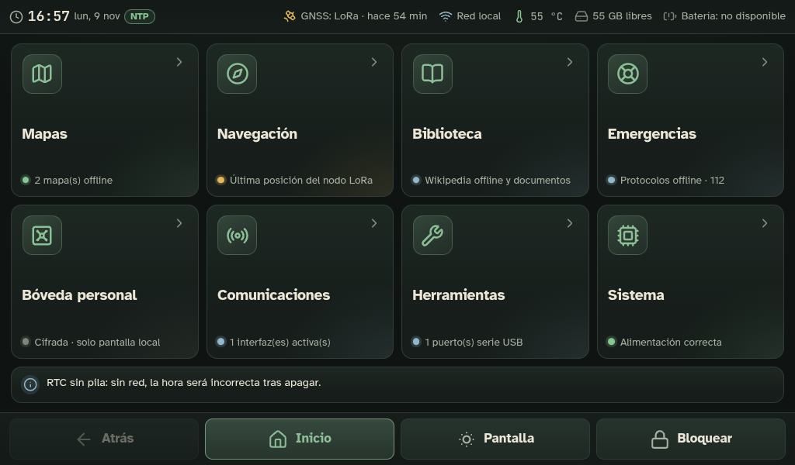

> Capturas reales del equipo (Raspberry Pi 5, 8 GB, pantalla 1024×600) con datos reales. En las capturas el mapa
> está centrado en Madrid y las direcciones de red aparecen difuminadas.

## Qué es

Survival OS convierte una Raspberry Pi 5 en una herramienta de consulta y comunicación para cuando no hay
Internet: un apagón largo, una zona sin cobertura, una salida al monte o una emergencia. Todo lo que necesita
está en el propio equipo:

- **Sin conexión de verdad.** Nada de CDN, fuentes ni APIs remotas. Una política CSP lo bloquea y
  `test-offline.sh` lo comprueba.
- **Datos honestos.** Si algo no se puede medir, la pantalla dice «no disponible» y por qué. Nunca muestra un
  valor inventado (contrato `Probe<T>`).
- **Pensado para el dedo.** Botones de 44 px o más, barra de acciones fija y modo noche. Arranca directamente en
  modo quiosco; el sistema tarda unos 10 s en arrancar (medido con `systemd-analyze`).
- **Privado por diseño.** La interfaz solo escucha en el propio equipo. La bóveda y el asistente nunca son
  accesibles desde la red.

## Funciones

### Emergencias: 41 protocolos y una guía para imprimir

<table><tr>
<td>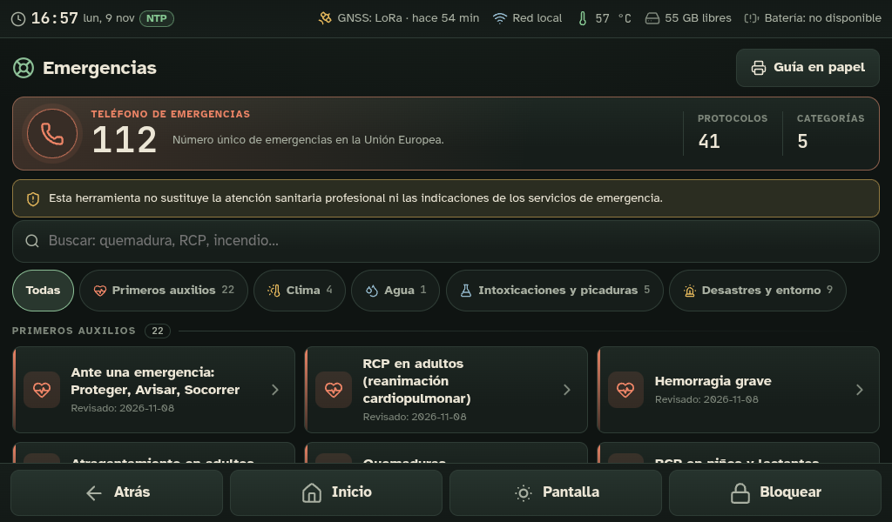</td>
<td>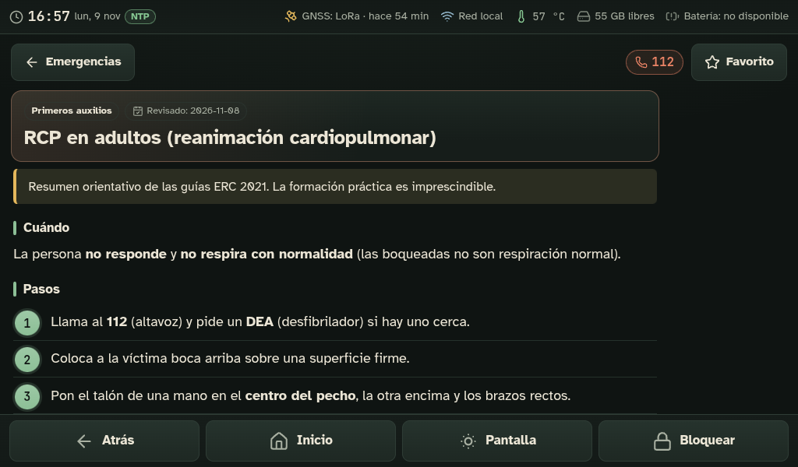</td>
</tr></table>

- **41 protocolos** en 5 categorías: primeros auxilios, clima, agua, intoxicaciones y picaduras, desastres y
  entorno. Incluyen RCP, hemorragias, atragantamiento, quemaduras, hipotermia, golpe de calor, potabilización,
  incendios, inundaciones…
- Cada protocolo indica sus **fuentes y fecha de revisión** (por ejemplo, las guías ERC 2021), con pasos
  numerados y avisos claros. Un revisor independiente comprobó los datos.
- Búsqueda instantánea, favoritos y acceso directo al **112**.
- **Guía en papel:** `npm run guide` genera un PDF en A5 y A4 con todos los protocolos, para tenerla impresa por
  si el equipo se queda sin batería.

### Mapas offline con rutas a pie, en bici y en coche

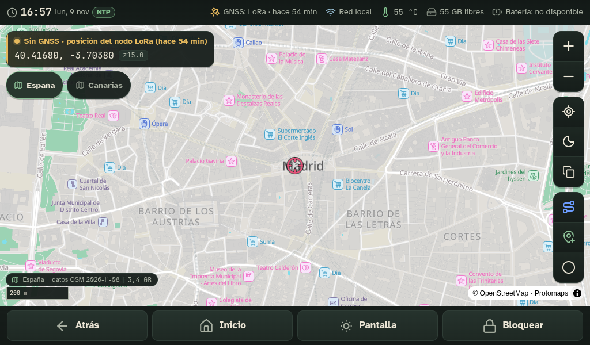

- Mapas vectoriales **PMTiles** de OpenStreetMap: España peninsular y Baleares (3,4 GB) y Canarias. Hasta el
  nivel de calle, con modo día y noche.
- **Rutas sin conexión** con [BRouter](https://github.com/abrensch/brouter), que se ejecuta en la propia Pi:
  - perfiles a pie, en bici y en coche, con distancia, tiempo y desnivel;
  - exportación a GPX;
  - un paseo de 3 km se calcula en 0,1 s; Madrid → Sevilla (531 km), en 10,5 s.
- Puntos guardados por tipo (agua, refugio, peligro…), track en grabación y coordenadas copiables.
- **Posición de respaldo por LoRa:** sin GPS propio, el mapa muestra la posición que llega por radio desde tu
  nodo Meshtastic. Indica su antigüedad y su precisión real.
- Enlaces directos a un punto: `/mapas?lat=40.4168&lon=-3.7038&z=15`.

### Biblioteca: la Wikipedia entera y más, sin Internet

<table><tr>
<td>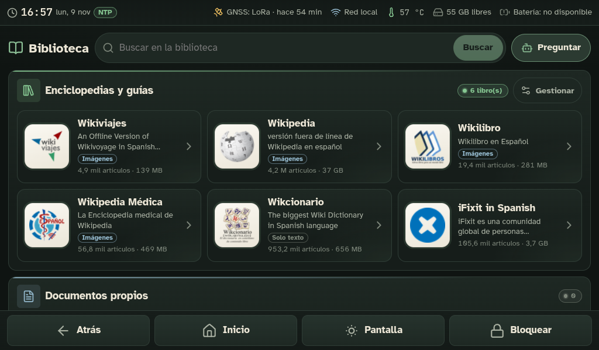</td>
<td>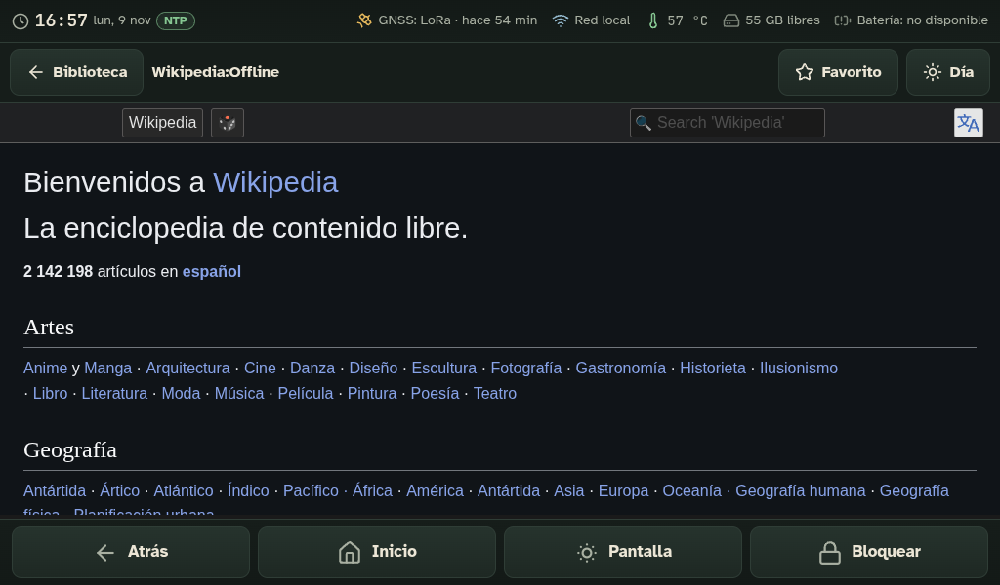</td>
</tr></table>

- Enciclopedias **Kiwix** (ZIM) con su lector integrado, pensado para la pantalla táctil:
  - **Wikipedia en español** (37 GB, 4,2 M artículos con imágenes);
  - Wikipedia Médica;
  - Wikiviajes;
  - Wikilibros;
  - Wikcionario;
  - **iFixit**, con guías de reparación.
- **Documentos propios** (PDF, Markdown, HTML, texto) con búsqueda de texto completo. Se importan desde un USB.
- Favoritos, modo noche y búsqueda unificada en todas las fuentes.

### Asistente de IA local

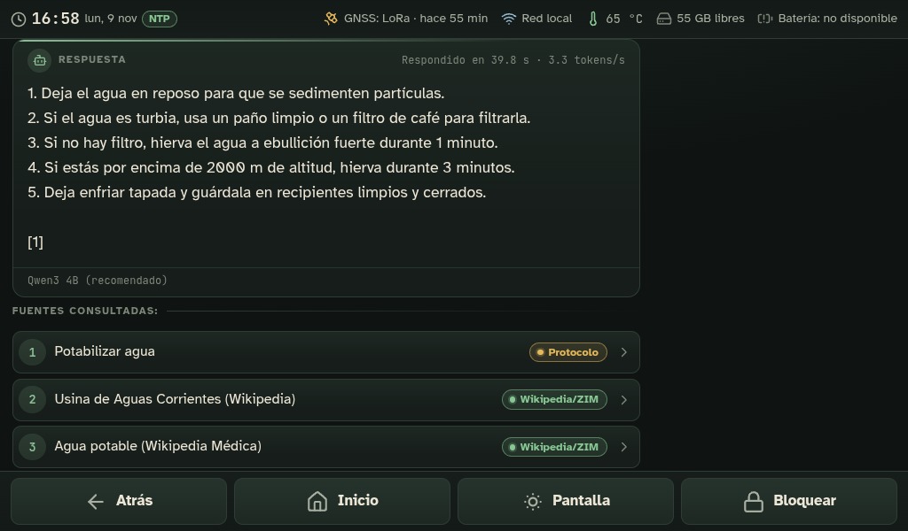

- Un modelo de lenguaje funcionando **en la propia Pi**: llama.cpp con Qwen3 4B; también se pueden instalar Gemma 3
  4B y Llama 3.2 3B. Ni la pregunta ni la respuesta salen del equipo.
- **Responde con fuentes:** primero busca en los protocolos de emergencia, después en Wikipedia y en los
  documentos propios, y **cita lo que ha consultado**.
- Rendimiento medido en la Pi 5: unos 40–60 s por respuesta (≈ 3,5 tokens/s).

### Malla LoRa (Meshtastic) y punto de acceso Wi-Fi

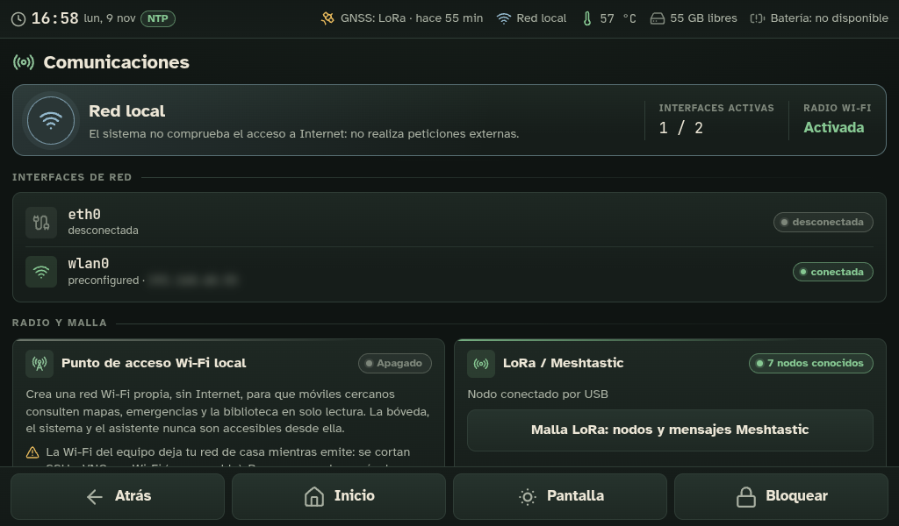

- **Mensajería por radio LoRa** (868 MHz) con nodos Meshtastic: lista de nodos (batería, señal, saltos), canales y
  mensajes, sin cobertura móvil.
- **Nodo base + nodo de bolsillo:** un Heltec V4 queda fijo en la Pi y otro va contigo emparejado al móvil. La
  Pi recibe tu posición **por radio, a kilómetros**. Va por un canal privado cifrado con precisión completa; el canal
  público queda como secundario.
- Botón **«Pedir posición ahora»**, con un límite de una petición por minuto por el ciclo de trabajo de la banda.
- **Punto de acceso Wi-Fi propio**, que se enciende y apaga desde la pantalla. Cualquier móvil cercano se conecta
  y consulta mapas, emergencias y biblioteca **en solo lectura**, sin Internet. Hay un portal cautivo, de modo que
  el móvil abre la app solo:

<table><tr>
<td width="50%">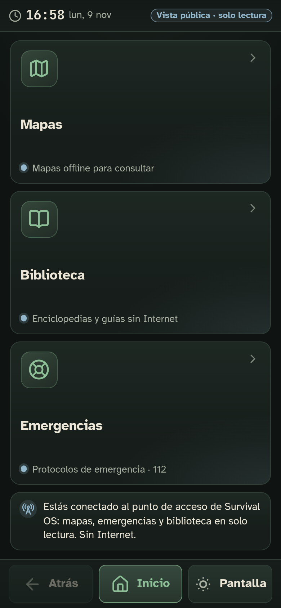</td>
<td width="50%">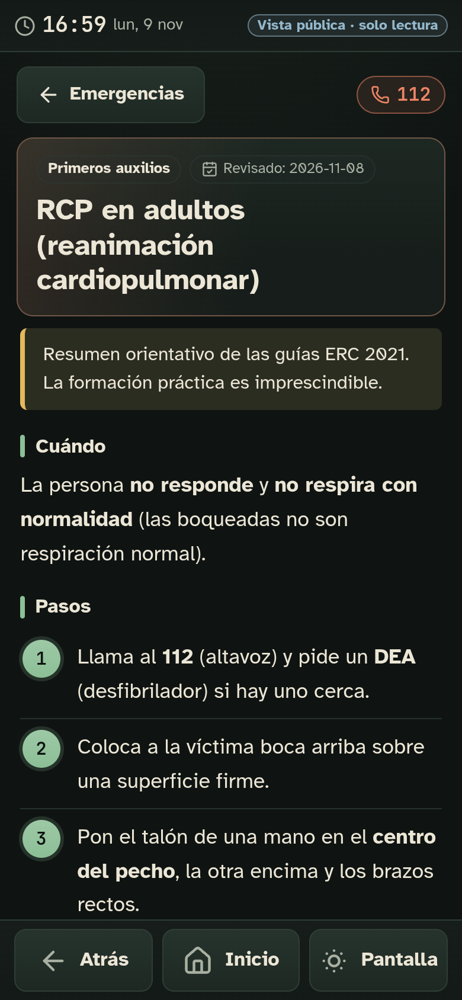</td>
</tr></table>

### Bóveda cifrada

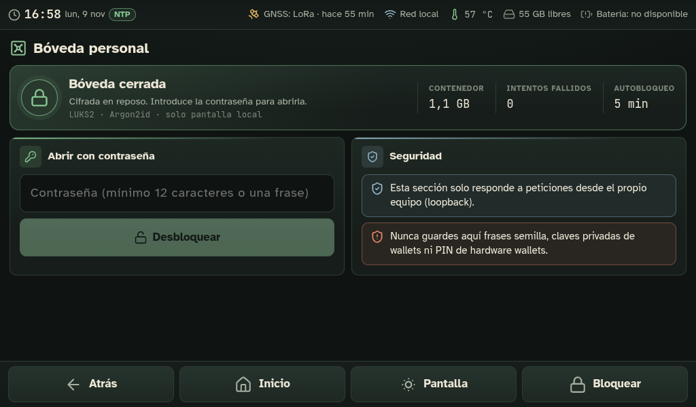

- Contenedor **LUKS2 con Argon2id** para documentos personales, gestionado por un servicio root aislado y sin red.
- Solo responde a la pantalla local. Se bloquea sola por inactividad y, tras cada intento fallido, la espera para
  volver a probar es mayor.
- Visor de imágenes a pantalla completa con zoom táctil. Permite renombrar e importar desde USB.

### Sistema, hora y mantenimiento

<table><tr>
<td>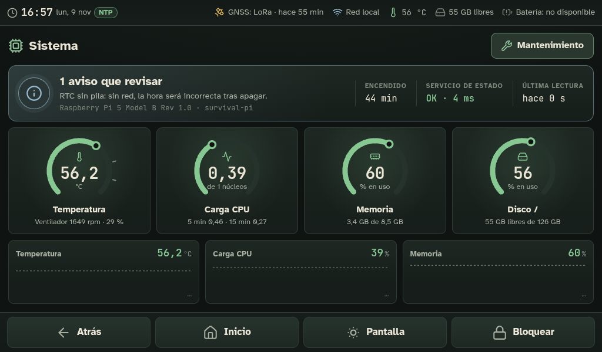</td>
<td>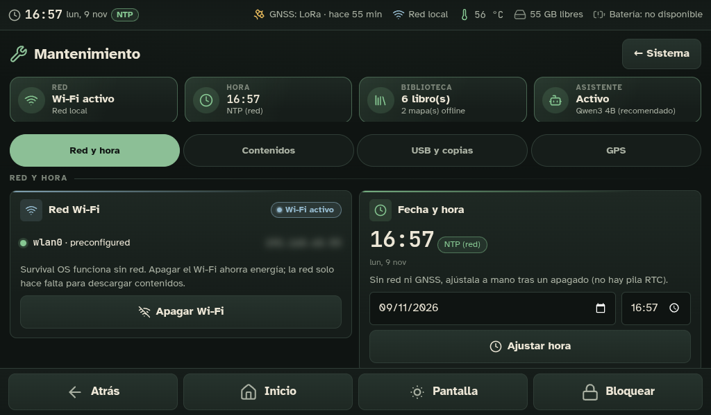</td>
</tr></table>

- Temperatura, ventilador, CPU, memoria y disco con su historial. También alimentación (subtensión),
  **salud de la microSD** (contadores de errores) y servicios.
- **Hora de respaldo sin Internet.** La Pi no tiene pila de reloj, así que corrige su hora con la del GPS de la
  base LoRa, que llega por el canal privado y exige dos muestras coincidentes. Probado: con el reloj atrasado 1 h a
  propósito, quedó a 0,2 s de la hora real.
- Mantenimiento desde la pantalla, con tareas root acotadas por polkit:
  - Wi-Fi, ajuste de hora y GPS;
  - descarga e importación de contenidos y mapas;
  - copias de seguridad en USB y actualizaciones;
  - instalación del asistente y de las rutas.
- Apagado de pantalla, bloqueo, reinicio y apagado seguros.

## Hardware

| Pieza | Uso |
|---|---|
| Raspberry Pi 5 (8 GB) | Equipo principal (probado con 8 GB) |
| Pantalla HDMI táctil 7" 1024×600 | Interfaz en modo quiosco (Wayland/labwc) |
| microSD o SSD de 128 GB o más | Sistema, Wikipedia (37 GB), mapas (3,5 GB), modelos de IA |
| 2 × Heltec WiFi LoRa 32 V4 *(opcional)* | Malla Meshtastic: base en la Pi + nodo de bolsillo |
| Módulo GNSS para la base *(opcional)* | Posición y hora sin Internet. Debe ir a 1–2 m de la Pi: la Pi 5 interfiere en la banda GPS |
| GPS USB *(opcional)* | Detectado automáticamente por gpsd |
| ESP32 por USB *(opcional)* | Sensores propios ([firmware de ejemplo](firmware/)) |

## Arquitectura

```text
apps/frontend/           Nuxt 4 (SPA) + servidor Nitro: interfaz, API, proxy a los servicios locales
services/device-api/     Estado del equipo (sysfs, /proc, vcgencmd, timedatectl, nmcli, systemctl)
services/library/        Protocolos, búsqueda FTS5, pasarela Kiwix, asistente (RAG + llama.cpp)
services/navigation/     Cliente gpsd, puntos, tracks GPX, posición de respaldo LoRa
services/vault/          Bóveda LUKS2 (root, sin red, socket Unix)
services/mesh/           Pasarela Meshtastic (Python, USB serie)
services/esp32-gateway/  ESP32 por USB serie (JSON Lines v1)
content/protocols/       41 protocolos de emergencia (Markdown con fuentes)
scripts/                 Instalación, tareas root, rutas (BRouter), hora de respaldo, pasarela pública…
systemd/                 Unidades survival-* (servicios aislados: IPAddressDeny, ProtectSystem…)
docs/                    Arquitectura, seguridad, hardware, puesta en marcha y decisiones (ADR)
```

Cada servicio escucha solo en loopback y con permisos mínimos. Los detalles están en el
[modelo de seguridad](docs/security-model.md) y en las [decisiones de arquitectura](docs/adr/).

## Instalación en la Raspberry Pi

Requisitos: Raspberry Pi OS (Bookworm, 64 bits) con escritorio, y Node ≥ 24.15 en el PC donde se compila.

```sh
# En el PC
npm install
node scripts/fetch-map-assets.mjs        # glifos y sprites del mapa (una vez)
npm run check                            # lint + tipos + pruebas
npm run build && npm run release         # → release/survival-os-X.Y.Z.tar.gz
scp release/survival-os-*.tar.gz scripts/install-system.sh <usuario>@<IP>:/tmp/

# En la Pi
sudo bash /tmp/install-system.sh /tmp/survival-os-X.Y.Z.tar.gz
```

El instalador hace lo siguiente:

- deja la aplicación en `/opt/survival-os` y crea el usuario de servicio `survival`;
- instala las unidades `survival-*`;
- activa el quiosco para el usuario de escritorio, que detecta solo.

Los contenidos (Wikipedia, mapas, asistente, rutas) se descargan después desde **Sistema → Mantenimiento**, o se
importan desde un USB sin red. La [puesta en marcha](docs/commissioning.md) explica cada paso. Para desinstalar,
`uninstall-system.sh`.

## Desarrollo

```sh
npm run dev      # device-api + Nuxt en 127.0.0.1:3000
npm run check    # obligatorio antes de desplegar
npm run e2e -- http://127.0.0.1:3000          # pruebas de pantalla por CDP (1024×600, táctil)
node tests/e2e/shots.mjs /tmp/shots           # regenerar estas capturas (en la Pi)
```

En Windows o macOS casi todas las sondas responden «no disponible (solo Linux)». Es lo correcto: la interfaz
muestra estados vacíos honestos. Para ver datos reales, despliega en la Pi.

## Estado

**v0.8.0.** Funciona en una Raspberry Pi 5 real, verificado allí:

- quiosco, mapas, rutas, biblioteca, asistente, bóveda, malla LoRa y hora de respaldo;
- 146 pruebas automáticas y pruebas E2E en escritorio y móvil.

Pendientes de prueba física:

- autonomía con batería;
- el punto de acceso con varios móviles a la vez;
- el alcance real de la radio LoRa en campo.

El [CHANGELOG](CHANGELOG.md) detalla cada versión.

> **Aviso:** los protocolos de emergencia son un resumen orientativo y **no sustituyen la formación ni la atención
> sanitaria profesional**. Ante una emergencia, llama al 112.

## Documentación

[Arquitectura](docs/architecture.md) · [Seguridad](docs/security-model.md) · [Hardware](docs/hardware-inventory.md) ·
[Puesta en marcha](docs/commissioning.md) · [Guía de campo](docs/field-guide.md) · [Energía](docs/power-tests.md) ·
[Fuentes y licencias](docs/content-sources.md) · [Diseño de la interfaz](docs/ui-design.md) · [ADR](docs/adr/)
